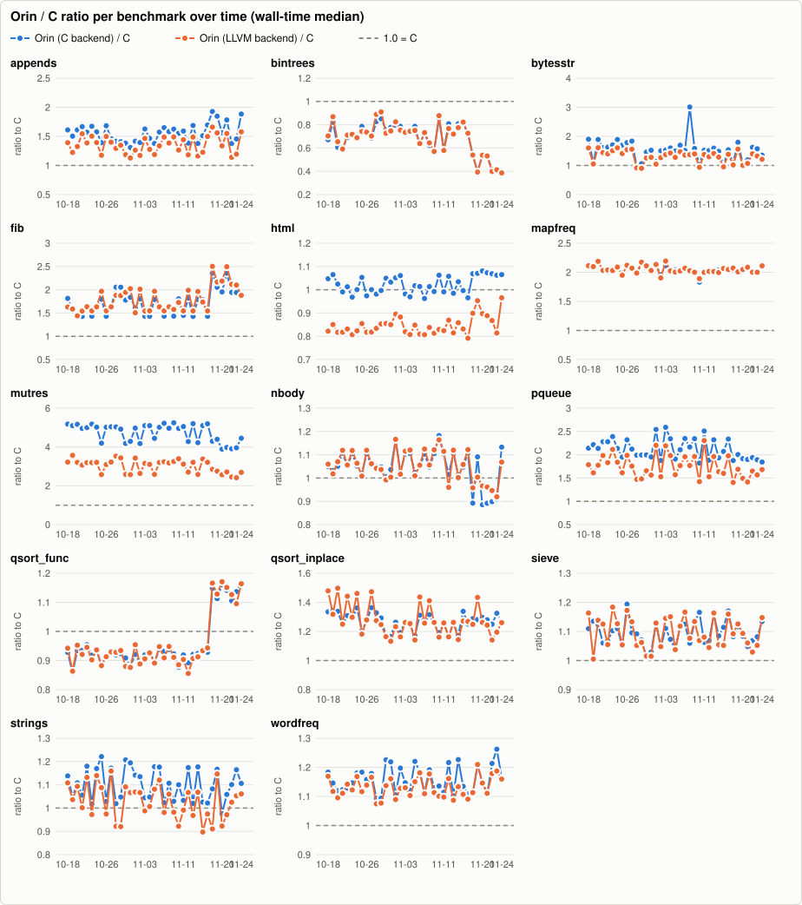
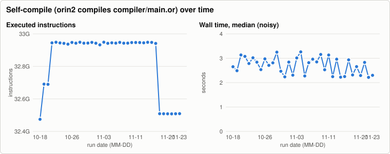

# Orin benchmark history

Written by `.github/workflows/bench.yml` (nightly and manual runs on `main`); one JSON file per run in [`history/`](history/), charts rendered by `tooling/benchmarks` (`bench-report render`, no external services). The same data as a stand-alone page: [`report.html`](report.html). Metrics and methodology: `docs/benchmarks.md` on `main`. Do not edit this branch by hand.

40 runs, 2026-10-18 to 2026-11-27. Latest: [`148472c2cd`](https://github.com/orin-lang/orin-lang/commit/148472c2cdb025d701598706b95f6b90f7f7fa44).

Instruction counts are the regression metric: they are deterministic for single-threaded programs, while wall time on a shared runner moves by 10-25 % between identical binaries.

## Latest run

Commit `148472c2cd` (main), 2026-11-27T13:36:10Z. Machine: AMD EPYC 9V74 80-Core Processor, 4 cores, 15.6 GiB, Linux-7.0.0-1020-azure-x86_64-with-glibc2.43. Runs per cell: 5 (median after one warm-up).

Tool versions

- cc: `cc (Ubuntu 15.2.0-16ubuntu1) 15.2.0`
- clang: `Ubuntu clang version 21.1.8 (6ubuntu1)`
- go: `go version go1.24.13 linux/amd64`
- java: `openjdk version "21.0.13" 2026-10-20 LTS`
- python: `3.14.4`
- rustc: `rustc 1.100.0 (0ef1bc386 2026-11-09)`
- valgrind: `valgrind-3.26.0`

### Wall time, seconds (median; min-max)

| benchmark | Orin (C backend) | Orin (LLVM backend) | C | Go | Java | Rust |
|---|---:|---:|---:|---:|---:|---:|
| appends | 0.007 (0.007-0.007) | 0.006 (0.006-0.006) | 0.004 (0.004-0.004) | 0.009 (0.009-0.010) | 0.064 (0.055-0.070) | 0.004 (0.004-0.004) |
| bintrees | 0.320 (0.317-0.325) | 0.318 (0.317-0.324) | 0.812 (0.805-0.814) | 0.960 (0.955-0.978) | 0.273 (0.268-0.275) | 0.961 (0.958-1.035) |
| bytesstr | 0.031 (0.031-0.031) | 0.027 (0.027-0.028) | 0.017 (0.017-0.017) | 0.009 (0.007-0.011) | 0.076 (0.074-0.086) | 0.033 (0.033-0.034) |
| fib | 0.275 (0.274-0.275) | 0.290 (0.289-0.290) | 0.134 (0.133-0.134) | 0.513 (0.510-0.515) | 0.319 (0.312-0.329) | 0.271 (0.271-0.272) |
| html | 0.122 (0.121-0.126) | 0.107 (0.106-0.109) | 0.113 (0.113-0.155) | 0.182 (0.176-0.188) | n/a | n/a |
| html_hand | 0.101 (0.100-0.104) | 0.087 (0.083-0.088) | n/a | n/a | n/a | n/a |
| http_parse | 0.092 (0.092-0.092) | 0.077 (0.077-0.077) | n/a | n/a | n/a | n/a |
| mapfreq | 0.120 (0.120-0.122) | 0.120 (0.120-0.121) | 0.060 (0.059-0.062) | 0.088 (0.088-0.089) | n/a | n/a |
| mutres | 0.140 (0.140-0.143) | 0.088 (0.087-0.088) | 0.032 (0.032-0.032) | 0.036 (0.036-0.037) | 0.067 (0.066-0.070) | 0.033 (0.032-0.033) |
| nbody | 0.070 (0.070-0.070) | 0.064 (0.064-0.064) | 0.064 (0.064-0.064) | 0.072 (0.071-0.073) | n/a | n/a |
| pqueue | 0.127 (0.124-0.129) | 0.106 (0.105-0.107) | 0.061 (0.061-0.061) | 0.163 (0.160-0.163) | 0.205 (0.193-0.209) | 0.075 (0.075-0.076) |
| qsort_func | 0.180 (0.178-0.186) | 0.182 (0.180-0.182) | 0.162 (0.161-0.163) | 0.304 (0.294-0.328) | n/a | n/a |
| qsort_inplace | 0.096 (0.096-0.096) | 0.108 (0.102-0.110) | 0.075 (0.075-0.076) | 0.105 (0.100-0.106) | n/a | n/a |
| sieve | 0.105 (0.102-0.107) | 0.108 (0.106-0.111) | 0.096 (0.092-0.098) | 0.205 (0.183-0.254) | 0.148 (0.140-0.154) | 0.103 (0.102-0.104) |
| sortedmap | 0.209 (0.207-0.211) | 0.215 (0.214-0.217) | n/a | n/a | n/a | n/a |
| streams | 0.116 (0.115-0.118) | 0.099 (0.098-0.100) | n/a | n/a | n/a | n/a |
| strings | 0.065 (0.064-0.065) | 0.064 (0.063-0.064) | 0.055 (0.055-0.056) | 0.064 (0.052-0.068) | 0.190 (0.189-0.204) | 0.025 (0.025-0.038) |
| tasks | 3.267 (3.231-3.325) | 3.260 (3.232-3.335) | n/a | n/a | n/a | n/a |
| url | 0.273 (0.270-0.292) | 0.241 (0.240-0.244) | n/a | n/a | n/a | n/a |
| wordfreq | 0.097 (0.096-0.097) | 0.097 (0.097-0.097) | 0.080 (0.080-0.081) | 0.094 (0.093-0.094) | n/a | n/a |

### Ratio to C (wall-time median; lower is better, 1.00x = as fast as C)

| benchmark | Orin C/C | Orin LLVM/C | Go/C | Java/C | Rust/C |
|---|---:|---:|---:|---:|---:|
| appends | 1.86x | 1.56x | 2.40x | 16.27x | 0.91x |
| bintrees | 0.39x | 0.39x | 1.18x | 0.34x | 1.18x |
| bytesstr | 1.80x | 1.58x | 0.50x | 4.38x | 1.94x |
| fib | 2.05x | 2.17x | 3.84x | 2.39x | 2.03x |
| html | 1.08x | 0.95x | 1.61x | n/a | n/a |
| html_hand | n/a | n/a | n/a | n/a | n/a |
| http_parse | n/a | n/a | n/a | n/a | n/a |
| mapfreq | 2.01x | 2.02x | 1.48x | n/a | n/a |
| mutres | 4.40x | 2.76x | 1.13x | 2.09x | 1.04x |
| nbody | 1.09x | 1.00x | 1.13x | n/a | n/a |
| pqueue | 2.07x | 1.73x | 2.66x | 3.35x | 1.23x |
| qsort_func | 1.11x | 1.12x | 1.87x | n/a | n/a |
| qsort_inplace | 1.27x | 1.43x | 1.39x | n/a | n/a |
| sieve | 1.09x | 1.12x | 2.13x | 1.54x | 1.07x |
| sortedmap | n/a | n/a | n/a | n/a | n/a |
| streams | n/a | n/a | n/a | n/a | n/a |
| strings | 1.18x | 1.16x | 1.16x | 3.47x | 0.46x |
| tasks | n/a | n/a | n/a | n/a | n/a |
| url | n/a | n/a | n/a | n/a | n/a |
| wordfreq | 1.20x | 1.21x | 1.16x | n/a | n/a |

### CPU time (user + sys, median s) and peak RSS (MiB)

| benchmark | orin CPU | llvm CPU | c CPU | go CPU | java CPU | rust CPU | orin RSS | llvm RSS | c RSS | go RSS | java RSS | rust RSS |
|---|---:|---:|---:|---:|---:|---:|---:|---:|---:|---:|---:|---:|
| appends | 0.007 | 0.006 | 0.004 | 0.013 | 0.089 | 0.003 | 4.8 | 5.0 | 4.8 | 10.9 | 47.9 | 5.1 |
| bintrees | 0.319 | 0.318 | 0.812 | 2.030 | 0.315 | 0.960 | 17.6 | 17.8 | 9.6 | 12.3 | 301.3 | 10.1 |
| bytesstr | 0.031 | 0.027 | 0.017 | 0.013 | 0.091 | 0.033 | 11.7 | 11.8 | 11.6 | 7.1 | 103.5 | 5.0 |
| fib | 0.274 | 0.289 | 0.133 | 0.514 | 0.330 | 0.271 | 1.6 | 1.8 | 1.5 | 1.7 | 38.7 | 2.0 |
| html | 0.121 | 0.107 | 0.113 | 0.239 | n/a | n/a | 3.9 | 4.2 | 2.1 | 7.8 | n/a | n/a |
| html_hand | 0.100 | 0.086 | n/a | n/a | n/a | n/a | 2.6 | 2.9 | n/a | n/a | n/a | n/a |
| http_parse | 0.092 | 0.077 | n/a | n/a | n/a | n/a | 1.8 | 1.9 | n/a | n/a | n/a | n/a |
| mapfreq | 0.120 | 0.120 | 0.059 | 0.098 | n/a | n/a | 11.2 | 11.4 | 5.0 | 7.7 | n/a | n/a |
| mutres | 0.140 | 0.087 | 0.032 | 0.036 | 0.091 | 0.033 | 1.6 | 1.8 | 1.5 | 1.7 | 39.1 | 2.1 |
| nbody | 0.069 | 0.064 | 0.064 | 0.073 | n/a | n/a | 1.9 | 1.9 | 1.8 | 1.7 | n/a | n/a |
| pqueue | 0.126 | 0.106 | 0.061 | 0.170 | 0.264 | 0.075 | 6.3 | 6.4 | 4.8 | 15.1 | 62.1 | 5.2 |
| qsort_func | 0.180 | 0.181 | 0.162 | 0.379 | n/a | n/a | 36.4 | 36.6 | 22.0 | 37.3 | n/a | n/a |
| qsort_inplace | 0.096 | 0.107 | 0.075 | 0.130 | n/a | n/a | 16.9 | 17.1 | 16.8 | 30.9 | n/a | n/a |
| sieve | 0.105 | 0.107 | 0.096 | 0.294 | 0.170 | 0.102 | 77.9 | 78.2 | 77.7 | 231.9 | 116.2 | 78.5 |
| sortedmap | 0.209 | 0.215 | n/a | n/a | n/a | n/a | 11.2 | 11.4 | n/a | n/a | n/a | n/a |
| streams | 0.116 | 0.098 | n/a | n/a | n/a | n/a | 39.9 | 40.1 | n/a | n/a | n/a | n/a |
| strings | 0.064 | 0.063 | 0.055 | 0.086 | 0.362 | 0.025 | 46.3 | 46.4 | 34.8 | 23.5 | 139.7 | 20.1 |
| tasks | 3.925 | 3.893 | n/a | n/a | n/a | n/a | 14.2 | 14.4 | n/a | n/a | n/a | n/a |
| url | 0.273 | 0.240 | n/a | n/a | n/a | n/a | 6.5 | 6.7 | n/a | n/a | n/a | n/a |
| wordfreq | 0.096 | 0.097 | 0.080 | 0.095 | n/a | n/a | 2.3 | 2.6 | 1.9 | 6.5 | n/a | n/a |

### Executed instructions (valgrind; the regression metric)

| benchmark | Orin C | Orin LLVM | C | Orin C/C | Orin LLVM/C | note |
|---|---:|---:|---:|---:|---:|---|
| appends | 60,400,606 | 43,975,658 | 18,927,362 | 3.19x | 2.32x |  |
| bintrees | 4,217,620,511 | 4,213,208,414 | 11,630,513,487 | 0.36x | 0.36x |  |
| bytesstr | 349,647,141 | 259,441,956 | 103,926,179 | 3.36x | 2.50x |  |
| fib | 3,200,259,808 | 2,342,472,432 | 2,780,168,025 | 1.15x | 0.84x |  |
| html | 1,578,539,715 | 1,381,614,046 | 1,521,579,597 | 1.04x | 0.91x |  |
| html_hand | 1,201,359,326 | 981,754,879 | n/a | n/a | n/a |  |
| http_parse | 1,466,351,609 | 1,315,702,334 | n/a | n/a | n/a |  |
| mapfreq | 1,013,671,870 | 996,589,343 | 681,408,294 | 1.49x | 1.46x |  |
| mutres | 2,280,222,342 | 1,420,196,407 | 267,648,838 | 8.52x | 5.31x |  |
| nbody | 655,257,509 | 768,198,964 | 386,175,662 | 1.70x | 1.99x |  |
| pqueue | 1,345,424,376 | 1,321,812,336 | 359,470,793 | 3.74x | 3.68x |  |
| qsort_func | 1,321,582,510 | 1,278,327,655 | 1,064,640,580 | 1.24x | 1.20x |  |
| qsort_inplace | 609,054,278 | 521,083,870 | 275,674,807 | 2.21x | 1.89x |  |
| sieve | 423,203,312 | 451,732,345 | 161,705,036 | 2.62x | 2.79x |  |
| sortedmap | 1,332,999,715 | 1,338,880,433 | n/a | n/a | n/a |  |
| streams | 1,207,160,677 | 1,173,802,976 | n/a | n/a | n/a |  |
| strings | 653,262,497 | 578,559,242 | 734,241,501 | 0.89x | 0.79x |  |
| tasks | n/a | n/a | n/a | n/a | n/a | llvm skipped: multi-threaded (20,000 tasks, channels): valgrind serialises threads, so the count would include scheduler waits; orin skipped: multi-threaded (20,000 tasks, channels): valgrind serialises threads, so the count would include scheduler waits |
| url | 4,188,201,717 | 4,071,298,635 | n/a | n/a | n/a |  |
| wordfreq | 758,664,398 | 707,702,180 | 864,991,374 | 0.88x | 0.82x |  |

### Parallel speedup (std:task; worker threads = first argument of the program)

| benchmark | threads | wall s (min-max) | CPU s (user+sys) | speedup | efficiency | CPU vs 1 thread | output |
|---|---:|---:|---:|---:|---:|---:|---|
| parallel_collatz | 1 | 0.410 (0.410-0.427) | 0.410 | 1.00x | 100 % | 1.00x | same |
| parallel_collatz | 2 | 0.244 (0.243-0.255) | 0.447 | 1.68x | 84 % | 1.09x | same |
| parallel_collatz | 4 | 0.149 (0.149-0.150) | 0.501 | 2.76x | 69 % | 1.22x | same |
| streams_parallel | 1 | 0.424 (0.424-0.428) | 0.424 | 1.00x | 100 % | 1.00x | same |
| streams_parallel | 2 | 0.221 (0.221-0.222) | 0.423 | 1.92x | 96 % | 1.00x | same |
| streams_parallel | 4 | 0.150 (0.149-0.151) | 0.536 | 2.83x | 71 % | 1.26x | same |

Speedup = wall(1 thread) / wall(n); efficiency = speedup / n. CPU time that grows with n is overhead or oversubscription (more threads than free cores).

### Self-compile (orin2 compiles compiler/main.or)

| wall s (min-max) | CPU s | peak RSS MiB | instructions | output identical to stage2.c |
|---:|---:|---:|---:|---|
| 2.575 (2.566-2.594) | 4.435 | 427.2 | 32,509,615,238 | yes |

## All runs

| date | commit | ref | self-compile instructions | self-compile wall s | file |
|---|---|---|---:|---:|---|
| 2026-11-27T13:36:10Z | `148472c2cd` | main | 32,509,615,238 | 2.575 | [json](history/2026-11-27-148472c2cdb0.json) |
| 2026-11-26T13:42:50Z | `148472c2cd` | main | 32,508,987,815 | 2.902 | [json](history/2026-11-26-148472c2cdb0.json) |
| 2026-11-25T14:02:25Z | `148472c2cd` | main | 32,508,995,900 | 2.807 | [json](history/2026-11-25-148472c2cdb0.json) |
| 2026-11-24T14:44:32Z | `148472c2cd` | main | 32,509,049,726 | 2.929 | [json](history/2026-11-24-148472c2cdb0.json) |
| 2026-11-23T14:06:57Z | `148472c2cd` | main | 32,509,283,292 | 2.302 | [json](history/2026-11-23-148472c2cdb0.json) |
| 2026-11-22T12:22:22Z | `148472c2cd` | main | 32,508,585,656 | 2.218 | [json](history/2026-11-22-148472c2cdb0.json) |
| 2026-11-21T12:14:55Z | `148472c2cd` | main | 32,507,877,584 | 2.830 | [json](history/2026-11-21-148472c2cdb0.json) |
| 2026-11-20T12:37:57Z | `148472c2cd` | main | 32,508,382,018 | 2.292 | [json](history/2026-11-20-148472c2cdb0.json) |
| 2026-11-18T12:45:56Z | `148472c2cd` | main | 32,508,554,009 | 2.657 | [json](history/2026-11-18-148472c2cdb0.json) |
| 2026-11-17T12:56:05Z | `148472c2cd` | main | 32,508,876,011 | 2.317 | [json](history/2026-11-17-148472c2cdb0.json) |
| 2026-11-16T12:36:50Z | `148472c2cd` | main | 32,941,276,491 | 2.935 | [json](history/2026-11-16-148472c2cdb0.json) |
| 2026-11-15T11:55:27Z | `148472c2cd` | main | 32,947,512,412 | 2.250 | [json](history/2026-11-15-148472c2cdb0.json) |
| 2026-11-14T11:18:28Z | `148472c2cd` | main | 32,948,196,811 | 2.224 | [json](history/2026-11-14-148472c2cdb0.json) |
| 2026-11-13T12:02:20Z | `148472c2cd` | main | 32,944,948,551 | 2.962 | [json](history/2026-11-13-148472c2cdb0.json) |
| 2026-11-12T12:13:12Z | `148472c2cd` | main | 32,946,589,724 | 2.245 | [json](history/2026-11-12-148472c2cdb0.json) |
| 2026-11-11T11:53:54Z | `148472c2cd` | main | 32,947,093,605 | 3.132 | [json](history/2026-11-11-148472c2cdb0.json) |
| 2026-11-10T12:13:41Z | `148472c2cd` | main | 32,946,478,802 | 2.528 | [json](history/2026-11-10-148472c2cdb0.json) |
| 2026-11-09T12:41:22Z | `148472c2cd` | main | 32,943,133,157 | 3.155 | [json](history/2026-11-09-148472c2cdb0.json) |
| 2026-11-08T11:10:36Z | `148472c2cd` | main | 32,942,986,207 | 2.851 | [json](history/2026-11-08-148472c2cdb0.json) |
| 2026-11-07T11:06:25Z | `148472c2cd` | main | 32,947,521,547 | 2.963 | [json](history/2026-11-07-148472c2cdb0.json) |
| 2026-11-06T11:56:28Z | `148472c2cd` | main | 32,943,001,622 | 2.818 | [json](history/2026-11-06-148472c2cdb0.json) |
| 2026-11-05T11:55:43Z | `148472c2cd` | main | 32,945,209,327 | 2.273 | [json](history/2026-11-05-148472c2cdb0.json) |
| 2026-11-04T12:03:12Z | `148472c2cd` | main | 32,941,929,762 | 3.262 | [json](history/2026-11-04-148472c2cdb0.json) |
| 2026-11-03T11:47:47Z | `148472c2cd` | main | 32,948,784,955 | 3.012 | [json](history/2026-11-03-148472c2cdb0.json) |
| 2026-11-02T12:05:49Z | `148472c2cd` | main | 32,932,422,001 | 2.307 | [json](history/2026-11-02-148472c2cdb0.json) |
| 2026-11-01T11:14:05Z | `148472c2cd` | main | 32,942,553,657 | 2.842 | [json](history/2026-11-01-148472c2cdb0.json) |
| 2026-10-31T10:16:06Z | `148472c2cd` | main | 32,947,431,130 | 2.238 | [json](history/2026-10-31-148472c2cdb0.json) |
| 2026-10-30T10:51:26Z | `148472c2cd` | main | 32,943,606,281 | 2.468 | [json](history/2026-10-30-148472c2cdb0.json) |
| 2026-10-29T10:55:59Z | `148472c2cd` | main | 32,942,981,735 | 3.250 | [json](history/2026-10-29-148472c2cdb0.json) |
| 2026-10-28T10:31:52Z | `148472c2cd` | main | 32,948,464,083 | 2.813 | [json](history/2026-10-28-148472c2cdb0.json) |
| 2026-10-27T09:43:14Z | `148472c2cd` | main | 32,942,699,177 | 2.709 | [json](history/2026-10-27-148472c2cdb0.json) |
| 2026-10-26T09:51:02Z | `148472c2cd` | main | 32,947,201,465 | 2.974 | [json](history/2026-10-26-148472c2cdb0.json) |
| 2026-10-25T09:03:06Z | `148472c2cd` | main | 32,936,964,885 | 2.535 | [json](history/2026-10-25-148472c2cdb0.json) |
| 2026-10-24T08:45:58Z | `148472c2cd` | main | 32,941,665,170 | 2.841 | [json](history/2026-10-24-148472c2cdb0.json) |
| 2026-10-23T09:15:05Z | `148472c2cd` | main | 32,944,434,877 | 3.020 | [json](history/2026-10-23-148472c2cdb0.json) |
| 2026-10-22T09:19:15Z | `148472c2cd` | main | 32,948,490,800 | 2.785 | [json](history/2026-10-22-148472c2cdb0.json) |
| 2026-10-21T09:18:17Z | `148472c2cd` | main | 32,944,599,759 | 3.076 | [json](history/2026-10-21-148472c2cdb0.json) |
| 2026-10-20T09:18:44Z | `4fca791aa7` | main | 32,689,556,132 | 3.135 | [json](history/2026-10-20-4fca791aa730.json) |
| 2026-10-19T09:42:12Z | `4fca791aa7` | main | 32,690,856,642 | 2.491 | [json](history/2026-10-19-4fca791aa730.json) |
| 2026-10-18T08:41:01Z | `f9a96b20cf` | main | 32,474,433,787 | 2.653 | [json](history/2026-10-18-f9a96b20cf4a.json) |
