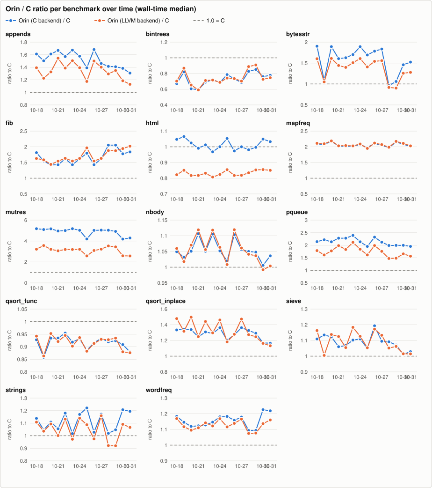
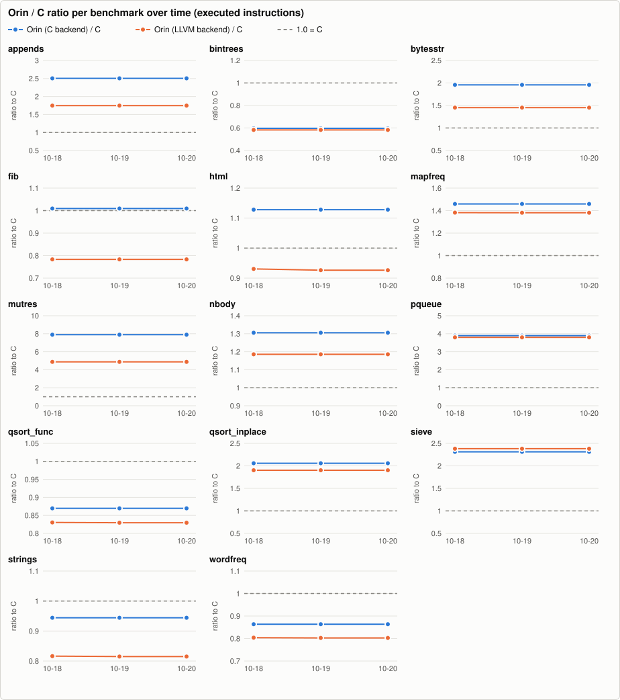
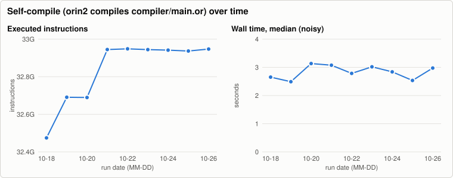
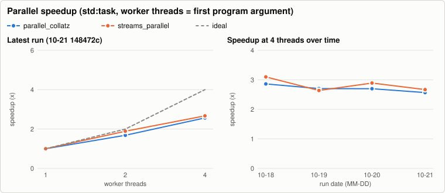

# Orin benchmark history

Written by `.github/workflows/bench.yml` (nightly and manual runs on `main`); one JSON file per run in [`history/`](history/), charts rendered by `tooling/benchmarks` (`bench-report render`, no external services). The same data as a stand-alone page: [`report.html`](report.html). Metrics and methodology: `docs/benchmarks.md` on `main`. Do not edit this branch by hand.

6 runs, 2026-10-18 to 2026-10-23. Latest: [`148472c2cd`](https://github.com/orin-lang/orin-lang/commit/148472c2cdb025d701598706b95f6b90f7f7fa44).

Instruction counts are the regression metric: they are deterministic for single-threaded programs, while wall time on a shared runner moves by 10-25 % between identical binaries.

## Latest run

Commit `148472c2cd` (main), 2026-10-23T09:15:05Z. Machine: AMD EPYC 7763 64-Core Processor, 4 cores, 15.6 GiB, Linux-6.17.0-1022-azure-x86_64-with-glibc2.39. Runs per cell: 5 (median after one warm-up).

Tool versions

- cc: `cc (Ubuntu 13.3.0-6ubuntu2~24.04.1) 13.3.0`
- clang: `Ubuntu clang version 18.1.3 (1ubuntu1)`
- go: `go version go1.24.13 linux/amd64`
- java: `openjdk version "21.0.12.1" 2026-08-18 LTS`
- python: `3.12.3`
- rustc: `rustc 1.99.1 (58cf8f9c3 2026-10-13)`
- valgrind: `valgrind-3.22.0`

### Wall time, seconds (median; min-max)

| benchmark | Orin (C backend) | Orin (LLVM backend) | C | Go | Java | Rust |
|---|---:|---:|---:|---:|---:|---:|
| appends | 0.009 (0.009-0.009) | 0.008 (0.008-0.008) | 0.005 (0.005-0.005) | 0.006 (0.006-0.007) | 0.068 (0.059-0.074) | 0.004 (0.004-0.004) |
| bintrees | 0.398 (0.397-0.412) | 0.395 (0.394-0.399) | 0.552 (0.539-0.569) | 1.296 (1.285-1.303) | 0.215 (0.214-0.227) | 0.711 (0.709-0.712) |
| bytesstr | 0.032 (0.032-0.033) | 0.028 (0.028-0.029) | 0.019 (0.018-0.019) | 0.008 (0.007-0.010) | 0.066 (0.065-0.072) | 0.035 (0.035-0.036) |
| fib | 0.283 (0.283-0.284) | 0.306 (0.306-0.308) | 0.198 (0.198-0.200) | 0.599 (0.598-0.605) | 0.418 (0.416-0.434) | 0.314 (0.313-0.315) |
| html | 0.163 (0.161-0.168) | 0.136 (0.134-0.137) | 0.168 (0.162-0.175) | 0.241 (0.229-0.266) | n/a | n/a |
| html_hand | 0.131 (0.130-0.141) | 0.101 (0.100-0.105) | n/a | n/a | n/a | n/a |
| http_parse | 0.126 (0.126-0.127) | 0.107 (0.107-0.109) | n/a | n/a | n/a | n/a |
| mapfreq | 0.156 (0.155-0.157) | 0.156 (0.155-0.157) | 0.077 (0.073-0.080) | 0.111 (0.110-0.111) | n/a | n/a |
| mutres | 0.164 (0.164-0.165) | 0.101 (0.101-0.101) | 0.032 (0.032-0.033) | 0.045 (0.044-0.045) | 0.084 (0.083-0.091) | 0.038 (0.038-0.039) |
| nbody | 0.078 (0.077-0.078) | 0.079 (0.078-0.082) | 0.070 (0.070-0.070) | 0.088 (0.086-0.090) | n/a | n/a |
| pqueue | 0.152 (0.149-0.157) | 0.134 (0.131-0.136) | 0.063 (0.063-0.064) | 0.192 (0.188-0.193) | 0.226 (0.221-0.232) | 0.091 (0.089-0.092) |
| qsort_func | 0.210 (0.210-0.211) | 0.207 (0.202-0.207) | 0.229 (0.227-0.230) | 0.347 (0.345-0.365) | n/a | n/a |
| qsort_inplace | 0.105 (0.104-0.105) | 0.105 (0.105-0.105) | 0.081 (0.081-0.081) | 0.091 (0.090-0.092) | n/a | n/a |
| sieve | 0.091 (0.090-0.094) | 0.098 (0.095-0.099) | 0.083 (0.081-0.084) | 0.127 (0.116-0.130) | 0.140 (0.135-0.148) | 0.086 (0.082-0.090) |
| sortedmap | 0.264 (0.261-0.271) | 0.272 (0.263-0.272) | n/a | n/a | n/a | n/a |
| streams | 0.108 (0.107-0.108) | 0.084 (0.083-0.085) | n/a | n/a | n/a | n/a |
| strings | 0.074 (0.074-0.074) | 0.071 (0.071-0.071) | 0.073 (0.073-0.073) | 0.057 (0.055-0.061) | 0.200 (0.195-0.205) | 0.028 (0.027-0.029) |
| tasks | 4.850 (4.786-5.027) | 4.905 (4.806-4.957) | n/a | n/a | n/a | n/a |
| url | 0.353 (0.351-0.355) | 0.310 (0.309-0.311) | n/a | n/a | n/a | n/a |
| wordfreq | 0.128 (0.126-0.130) | 0.125 (0.125-0.127) | 0.111 (0.110-0.114) | 0.111 (0.109-0.111) | n/a | n/a |

### Ratio to C (wall-time median; lower is better, 1.00x = as fast as C)

| benchmark | Orin C/C | Orin LLVM/C | Go/C | Java/C | Rust/C |
|---|---:|---:|---:|---:|---:|
| appends | 1.67x | 1.50x | 1.24x | 13.26x | 0.85x |
| bintrees | 0.72x | 0.72x | 2.35x | 0.39x | 1.29x |
| bytesstr | 1.70x | 1.51x | 0.40x | 3.48x | 1.87x |
| fib | 1.43x | 1.55x | 3.03x | 2.11x | 1.58x |
| html | 0.97x | 0.81x | 1.43x | n/a | n/a |
| html_hand | n/a | n/a | n/a | n/a | n/a |
| http_parse | n/a | n/a | n/a | n/a | n/a |
| mapfreq | 2.03x | 2.03x | 1.44x | n/a | n/a |
| mutres | 5.18x | 3.19x | 1.40x | 2.65x | 1.20x |
| nbody | 1.11x | 1.12x | 1.26x | n/a | n/a |
| pqueue | 2.39x | 2.11x | 3.02x | 3.56x | 1.43x |
| qsort_func | 0.92x | 0.90x | 1.52x | n/a | n/a |
| qsort_inplace | 1.29x | 1.30x | 1.12x | n/a | n/a |
| sieve | 1.10x | 1.18x | 1.53x | 1.68x | 1.04x |
| sortedmap | n/a | n/a | n/a | n/a | n/a |
| streams | n/a | n/a | n/a | n/a | n/a |
| strings | 1.02x | 0.97x | 0.79x | 2.75x | 0.39x |
| tasks | n/a | n/a | n/a | n/a | n/a |
| url | n/a | n/a | n/a | n/a | n/a |
| wordfreq | 1.15x | 1.12x | 0.99x | n/a | n/a |

### CPU time (user + sys, median s) and peak RSS (MiB)

| benchmark | orin CPU | llvm CPU | c CPU | go CPU | java CPU | rust CPU | orin RSS | llvm RSS | c RSS | go RSS | java RSS | rust RSS |
|---|---:|---:|---:|---:|---:|---:|---:|---:|---:|---:|---:|---:|
| appends | 0.008 | 0.008 | 0.005 | 0.008 | 0.097 | 0.004 | 4.5 | 4.8 | 4.7 | 10.5 | 58.6 | 5.0 |
| bintrees | 0.398 | 0.395 | 0.551 | 2.812 | 0.266 | 0.711 | 17.5 | 17.8 | 9.5 | 14.2 | 307.7 | 10.0 |
| bytesstr | 0.032 | 0.028 | 0.019 | 0.010 | 0.084 | 0.035 | 11.5 | 11.7 | 11.5 | 9.9 | 108.0 | 4.8 |
| fib | 0.283 | 0.306 | 0.198 | 0.601 | 0.432 | 0.313 | 1.5 | 1.7 | 1.5 | 3.4 | 47.5 | 1.9 |
| html | 0.162 | 0.135 | 0.168 | 0.322 | n/a | n/a | 3.7 | 4.1 | 2.1 | 8.3 | n/a | n/a |
| html_hand | 0.131 | 0.100 | n/a | n/a | n/a | n/a | 2.4 | 2.8 | n/a | n/a | n/a | n/a |
| http_parse | 0.126 | 0.106 | n/a | n/a | n/a | n/a | 1.6 | 1.9 | n/a | n/a | n/a | n/a |
| mapfreq | 0.155 | 0.155 | 0.074 | 0.126 | n/a | n/a | 11.3 | 11.6 | 5.0 | 9.9 | n/a | n/a |
| mutres | 0.164 | 0.101 | 0.031 | 0.045 | 0.116 | 0.038 | 1.5 | 1.8 | 1.5 | 3.4 | 47.8 | 2.0 |
| nbody | 0.077 | 0.078 | 0.070 | 0.089 | n/a | n/a | 1.8 | 1.8 | 1.8 | 3.4 | n/a | n/a |
| pqueue | 0.151 | 0.134 | 0.063 | 0.198 | 0.303 | 0.091 | 6.1 | 6.3 | 4.7 | 16.0 | 70.3 | 5.0 |
| qsort_func | 0.210 | 0.206 | 0.229 | 0.422 | n/a | n/a | 36.4 | 36.7 | 23.7 | 42.4 | n/a | n/a |
| qsort_inplace | 0.104 | 0.105 | 0.081 | 0.099 | n/a | n/a | 16.7 | 17.0 | 16.8 | 31.6 | n/a | n/a |
| sieve | 0.091 | 0.098 | 0.083 | 0.168 | 0.169 | 0.086 | 79.0 | 79.3 | 78.4 | 275.9 | 124.5 | 79.1 |
| sortedmap | 0.263 | 0.271 | n/a | n/a | n/a | n/a | 11.1 | 11.4 | n/a | n/a | n/a | n/a |
| streams | 0.107 | 0.084 | n/a | n/a | n/a | n/a | 43.0 | 40.8 | n/a | n/a | n/a | n/a |
| strings | 0.074 | 0.070 | 0.073 | 0.069 | 0.413 | 0.028 | 47.4 | 47.7 | 36.4 | 25.8 | 145.6 | 20.0 |
| tasks | 5.443 | 5.467 | n/a | n/a | n/a | n/a | 18.1 | 18.4 | n/a | n/a | n/a | n/a |
| url | 0.352 | 0.310 | n/a | n/a | n/a | n/a | 6.4 | 6.7 | n/a | n/a | n/a | n/a |
| wordfreq | 0.127 | 0.125 | 0.111 | 0.113 | n/a | n/a | 2.2 | 2.5 | 1.9 | 7.9 | n/a | n/a |

### Executed instructions (valgrind; the regression metric)

| benchmark | Orin C | Orin LLVM | C | Orin C/C | Orin LLVM/C | note |
|---|---:|---:|---:|---:|---:|---|
| appends | 63,532,187 | 44,305,032 | 25,381,145 | 2.50x | 1.75x |  |
| bintrees | 4,323,683,959 | 4,219,297,433 | 7,242,293,424 | 0.60x | 0.58x |  |
| bytesstr | 349,909,247 | 259,440,726 | 178,695,488 | 1.96x | 1.45x |  |
| fib | 3,200,320,090 | 2,483,953,632 | 3,170,983,196 | 1.01x | 0.78x |  |
| html | 1,786,500,083 | 1,465,345,190 | 1,581,660,476 | 1.13x | 0.93x |  |
| html_hand | 1,335,187,104 | 980,559,857 | n/a | n/a | n/a |  |
| http_parse | 1,494,543,487 | 1,314,023,622 | n/a | n/a | n/a |  |
| mapfreq | 1,050,476,715 | 993,975,283 | 719,855,456 | 1.46x | 1.38x |  |
| mutres | 2,300,282,894 | 1,420,255,452 | 291,450,138 | 7.89x | 4.87x |  |
| nbody | 850,321,961 | 772,258,358 | 651,230,701 | 1.31x | 1.19x |  |
| pqueue | 1,383,801,416 | 1,349,545,582 | 355,213,580 | 3.90x | 3.80x |  |
| qsort_func | 1,335,897,346 | 1,268,411,938 | 1,528,677,752 | 0.87x | 0.83x |  |
| qsort_inplace | 563,393,087 | 521,077,314 | 273,751,964 | 2.06x | 1.90x |  |
| sieve | 443,197,999 | 456,725,913 | 191,756,547 | 2.31x | 2.38x |  |
| sortedmap | 1,354,678,405 | 1,354,047,028 | n/a | n/a | n/a |  |
| streams | 1,173,757,219 | 1,173,731,136 | n/a | n/a | n/a |  |
| strings | 647,534,763 | 558,940,700 | 685,893,530 | 0.94x | 0.81x |  |
| tasks | n/a | n/a | n/a | n/a | n/a | llvm skipped: multi-threaded (20,000 tasks, channels): valgrind serialises threads, so the count would include scheduler waits; orin skipped: multi-threaded (20,000 tasks, channels): valgrind serialises threads, so the count would include scheduler waits |
| url | 4,455,707,373 | 4,066,090,876 | n/a | n/a | n/a |  |
| wordfreq | 760,380,161 | 706,684,023 | 880,390,180 | 0.86x | 0.80x |  |

### Parallel speedup (std:task; worker threads = first argument of the program)

| benchmark | threads | wall s (min-max) | CPU s (user+sys) | speedup | efficiency | CPU vs 1 thread | output |
|---|---:|---:|---:|---:|---:|---:|---|
| parallel_collatz | 1 | 0.493 (0.491-0.493) | 0.492 | 1.00x | 100 % | 1.00x | same |
| parallel_collatz | 2 | 0.271 (0.270-0.273) | 0.506 | 1.82x | 91 % | 1.03x | same |
| parallel_collatz | 4 | 0.178 (0.176-0.180) | 0.626 | 2.77x | 69 % | 1.27x | same |
| streams_parallel | 1 | 0.480 (0.479-0.480) | 0.479 | 1.00x | 100 % | 1.00x | same |
| streams_parallel | 2 | 0.247 (0.247-0.255) | 0.481 | 1.94x | 97 % | 1.00x | same |
| streams_parallel | 4 | 0.172 (0.171-0.175) | 0.645 | 2.79x | 70 % | 1.35x | same |

Speedup = wall(1 thread) / wall(n); efficiency = speedup / n. CPU time that grows with n is overhead or oversubscription (more threads than free cores).

### Self-compile (orin2 compiles compiler/main.or)

| wall s (min-max) | CPU s | peak RSS MiB | instructions | output identical to stage2.c |
|---:|---:|---:|---:|---|
| 3.020 (2.996-3.026) | 5.377 | 431.3 | 32,944,434,877 | yes |

## All runs

| date | commit | ref | self-compile instructions | self-compile wall s | file |
|---|---|---|---:|---:|---|
| 2026-10-23T09:15:05Z | `148472c2cd` | main | 32,944,434,877 | 3.020 | [json](history/2026-10-23-148472c2cdb0.json) |
| 2026-10-22T09:19:15Z | `148472c2cd` | main | 32,948,490,800 | 2.785 | [json](history/2026-10-22-148472c2cdb0.json) |
| 2026-10-21T09:18:17Z | `148472c2cd` | main | 32,944,599,759 | 3.076 | [json](history/2026-10-21-148472c2cdb0.json) |
| 2026-10-20T09:18:44Z | `4fca791aa7` | main | 32,689,556,132 | 3.135 | [json](history/2026-10-20-4fca791aa730.json) |
| 2026-10-19T09:42:12Z | `4fca791aa7` | main | 32,690,856,642 | 2.491 | [json](history/2026-10-19-4fca791aa730.json) |
| 2026-10-18T08:41:01Z | `f9a96b20cf` | main | 32,474,433,787 | 2.653 | [json](history/2026-10-18-f9a96b20cf4a.json) |
