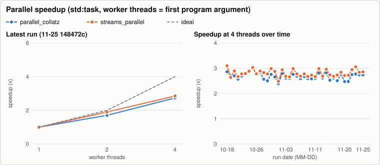

# Orin benchmark history

Written by `.github/workflows/bench.yml` (nightly and manual runs on `main`); one JSON file per run in [`history/`](history/), charts rendered by `tooling/benchmarks` (`bench-report render`, no external services). The same data as a stand-alone page: [`report.html`](report.html). Metrics and methodology: `docs/benchmarks.md` on `main`. Do not edit this branch by hand.

29 runs, 2026-10-18 to 2026-11-15. Latest: [`148472c2cd`](https://github.com/orin-lang/orin-lang/commit/148472c2cdb025d701598706b95f6b90f7f7fa44).

Instruction counts are the regression metric: they are deterministic for single-threaded programs, while wall time on a shared runner moves by 10-25 % between identical binaries.

## Latest run

Commit `148472c2cd` (main), 2026-11-15T11:55:27Z. Machine: Intel(R) Xeon(R) 6975P-C, 4 cores, 15.3 GiB, Linux-7.0.0-1014-aws-x86_64-with-glibc2.39. Runs per cell: 5 (median after one warm-up).

Tool versions

- cc: `cc (Ubuntu 13.3.0-6ubuntu2~24.04.1) 13.3.0`
- clang: `Ubuntu clang version 18.1.3 (1ubuntu1)`
- go: `go version go1.24.13 linux/amd64`
- java: `openjdk version "21.0.13" 2026-10-20 LTS`
- python: `3.12.3`
- rustc: `rustc 1.100.0 (0ef1bc386 2026-11-09)`
- valgrind: `valgrind-3.22.0`

### Wall time, seconds (median; min-max)

| benchmark | Orin (C backend) | Orin (LLVM backend) | C | Go | Java | Rust |
|---|---:|---:|---:|---:|---:|---:|
| appends | 0.005 (0.005-0.005) | 0.004 (0.004-0.004) | 0.003 (0.003-0.003) | 0.007 (0.006-0.008) | 0.048 (0.046-0.063) | 0.003 (0.003-0.003) |
| bintrees | 0.357 (0.354-0.359) | 0.363 (0.360-0.367) | 0.441 (0.434-0.443) | 0.889 (0.884-0.890) | 0.271 (0.264-0.277) | 0.561 (0.560-0.563) |
| bytesstr | 0.034 (0.034-0.034) | 0.032 (0.032-0.035) | 0.034 (0.033-0.034) | 0.008 (0.008-0.008) | 0.072 (0.071-0.079) | 0.026 (0.025-0.026) |
| fib | 0.247 (0.247-0.247) | 0.240 (0.240-0.240) | 0.138 (0.138-0.139) | 0.420 (0.420-0.422) | 0.349 (0.349-0.351) | 0.235 (0.235-0.236) |
| html | 0.112 (0.111-0.113) | 0.093 (0.093-0.094) | 0.112 (0.112-0.112) | 0.196 (0.192-0.200) | n/a | n/a |
| html_hand | 0.097 (0.097-0.097) | 0.070 (0.069-0.075) | n/a | n/a | n/a | n/a |
| http_parse | 0.088 (0.088-0.088) | 0.073 (0.073-0.074) | n/a | n/a | n/a | n/a |
| mapfreq | 0.121 (0.120-0.121) | 0.121 (0.120-0.121) | 0.058 (0.058-0.060) | 0.085 (0.084-0.087) | n/a | n/a |
| mutres | 0.102 (0.102-0.103) | 0.067 (0.067-0.068) | 0.020 (0.020-0.020) | 0.060 (0.059-0.060) | 0.062 (0.058-0.068) | 0.024 (0.024-0.025) |
| nbody | 0.046 (0.046-0.047) | 0.046 (0.045-0.047) | 0.044 (0.044-0.044) | 0.069 (0.069-0.069) | n/a | n/a |
| pqueue | 0.122 (0.121-0.122) | 0.094 (0.094-0.095) | 0.059 (0.059-0.059) | 0.145 (0.144-0.148) | 0.204 (0.196-0.217) | 0.072 (0.072-0.072) |
| qsort_func | 0.179 (0.178-0.181) | 0.178 (0.177-0.179) | 0.191 (0.189-0.194) | 0.328 (0.323-0.330) | n/a | n/a |
| qsort_inplace | 0.101 (0.100-0.102) | 0.096 (0.095-0.097) | 0.076 (0.075-0.077) | 0.094 (0.093-0.094) | n/a | n/a |
| sieve | 0.106 (0.105-0.108) | 0.100 (0.098-0.101) | 0.095 (0.095-0.099) | 0.246 (0.221-0.291) | 0.143 (0.139-0.152) | 0.087 (0.087-0.089) |
| sortedmap | 0.209 (0.208-0.209) | 0.213 (0.213-0.214) | n/a | n/a | n/a | n/a |
| streams | 0.082 (0.081-0.090) | 0.084 (0.083-0.086) | n/a | n/a | n/a | n/a |
| strings | 0.047 (0.047-0.052) | 0.041 (0.041-0.042) | 0.046 (0.045-0.046) | 0.048 (0.045-0.052) | 0.178 (0.171-0.186) | 0.021 (0.021-0.021) |
| tasks | 2.409 (2.292-2.435) | 2.375 (2.238-2.530) | n/a | n/a | n/a | n/a |
| url | 0.241 (0.241-0.244) | 0.224 (0.222-0.225) | n/a | n/a | n/a | n/a |
| wordfreq | 0.089 (0.088-0.089) | 0.087 (0.086-0.087) | 0.078 (0.078-0.079) | 0.090 (0.089-0.091) | n/a | n/a |

### Ratio to C (wall-time median; lower is better, 1.00x = as fast as C)

| benchmark | Orin C/C | Orin LLVM/C | Go/C | Java/C | Rust/C |
|---|---:|---:|---:|---:|---:|
| appends | 1.51x | 1.23x | 2.18x | 14.92x | 0.83x |
| bintrees | 0.81x | 0.82x | 2.02x | 0.62x | 1.27x |
| bytesstr | 1.01x | 0.95x | 0.24x | 2.13x | 0.76x |
| fib | 1.78x | 1.74x | 3.04x | 2.52x | 1.70x |
| html | 1.00x | 0.83x | 1.74x | n/a | n/a |
| html_hand | n/a | n/a | n/a | n/a | n/a |
| http_parse | n/a | n/a | n/a | n/a | n/a |
| mapfreq | 2.06x | 2.07x | 1.46x | n/a | n/a |
| mutres | 5.10x | 3.38x | 2.99x | 3.11x | 1.21x |
| nbody | 1.05x | 1.06x | 1.57x | n/a | n/a |
| pqueue | 2.07x | 1.60x | 2.47x | 3.47x | 1.22x |
| qsort_func | 0.94x | 0.93x | 1.72x | n/a | n/a |
| qsort_inplace | 1.34x | 1.27x | 1.24x | n/a | n/a |
| sieve | 1.11x | 1.05x | 2.58x | 1.50x | 0.92x |
| sortedmap | n/a | n/a | n/a | n/a | n/a |
| streams | n/a | n/a | n/a | n/a | n/a |
| strings | 1.03x | 0.90x | 1.05x | 3.88x | 0.46x |
| tasks | n/a | n/a | n/a | n/a | n/a |
| url | n/a | n/a | n/a | n/a | n/a |
| wordfreq | 1.13x | 1.11x | 1.15x | n/a | n/a |

### CPU time (user + sys, median s) and peak RSS (MiB)

| benchmark | orin CPU | llvm CPU | c CPU | go CPU | java CPU | rust CPU | orin RSS | llvm RSS | c RSS | go RSS | java RSS | rust RSS |
|---|---:|---:|---:|---:|---:|---:|---:|---:|---:|---:|---:|---:|
| appends | 0.005 | 0.004 | 0.003 | 0.010 | 0.078 | 0.002 | 4.6 | 4.8 | 4.9 | 9.0 | 48.0 | 5.2 |
| bintrees | 0.356 | 0.362 | 0.440 | 1.966 | 0.312 | 0.561 | 17.6 | 17.9 | 9.7 | 13.2 | 296.1 | 10.1 |
| bytesstr | 0.034 | 0.032 | 0.033 | 0.011 | 0.087 | 0.025 | 11.6 | 11.9 | 11.7 | 6.3 | 102.9 | 4.9 |
| fib | 0.246 | 0.240 | 0.138 | 0.422 | 0.360 | 0.235 | 1.6 | 1.9 | 1.6 | 1.6 | 38.6 | 2.0 |
| html | 0.112 | 0.093 | 0.112 | 0.256 | n/a | n/a | 3.9 | 4.2 | 2.2 | 7.8 | n/a | n/a |
| html_hand | 0.097 | 0.069 | n/a | n/a | n/a | n/a | 2.5 | 2.9 | n/a | n/a | n/a | n/a |
| http_parse | 0.088 | 0.073 | n/a | n/a | n/a | n/a | 1.7 | 2.1 | n/a | n/a | n/a | n/a |
| mapfreq | 0.120 | 0.121 | 0.058 | 0.101 | n/a | n/a | 11.4 | 11.7 | 5.1 | 7.5 | n/a | n/a |
| mutres | 0.102 | 0.067 | 0.020 | 0.060 | 0.084 | 0.024 | 1.6 | 1.9 | 1.6 | 1.7 | 39.0 | 2.1 |
| nbody | 0.046 | 0.046 | 0.044 | 0.069 | n/a | n/a | 1.9 | 1.9 | 1.9 | 1.6 | n/a | n/a |
| pqueue | 0.122 | 0.094 | 0.059 | 0.151 | 0.260 | 0.072 | 6.2 | 6.5 | 4.9 | 15.5 | 61.9 | 5.2 |
| qsort_func | 0.178 | 0.178 | 0.191 | 0.395 | n/a | n/a | 36.5 | 36.8 | 23.8 | 36.3 | n/a | n/a |
| qsort_inplace | 0.101 | 0.096 | 0.075 | 0.108 | n/a | n/a | 16.8 | 17.1 | 16.9 | 24.3 | n/a | n/a |
| sieve | 0.106 | 0.100 | 0.095 | 0.371 | 0.163 | 0.087 | 77.8 | 78.1 | 77.7 | 231.7 | 116.0 | 78.3 |
| sortedmap | 0.208 | 0.212 | n/a | n/a | n/a | n/a | 11.3 | 11.5 | n/a | n/a | n/a | n/a |
| streams | 0.082 | 0.084 | n/a | n/a | n/a | n/a | 39.8 | 40.0 | n/a | n/a | n/a | n/a |
| strings | 0.047 | 0.041 | 0.046 | 0.062 | 0.367 | 0.021 | 46.2 | 46.5 | 34.7 | 23.5 | 139.5 | 20.0 |
| tasks | 3.312 | 3.337 | n/a | n/a | n/a | n/a | 14.2 | 14.6 | n/a | n/a | n/a | n/a |
| url | 0.241 | 0.224 | n/a | n/a | n/a | n/a | 6.5 | 6.8 | n/a | n/a | n/a | n/a |
| wordfreq | 0.088 | 0.086 | 0.078 | 0.092 | n/a | n/a | 2.4 | 2.6 | 2.0 | 6.7 | n/a | n/a |

### Executed instructions (valgrind; the regression metric)

| benchmark | Orin C | Orin LLVM | C | Orin C/C | Orin LLVM/C | note |
|---|---:|---:|---:|---:|---:|---|
| appends | 63,531,573 | 44,304,671 | 25,380,528 | 2.50x | 1.75x |  |
| bintrees | 4,323,683,331 | 4,219,297,058 | 7,242,292,830 | 0.60x | 0.58x |  |
| bytesstr | 349,908,619 | 259,440,351 | 178,694,894 | 1.96x | 1.45x |  |
| fib | 3,200,319,481 | 2,483,953,276 | 3,170,982,574 | 1.01x | 0.78x |  |
| html | 1,786,499,460 | 1,465,344,820 | 1,581,659,887 | 1.13x | 0.93x |  |
| html_hand | 1,335,186,504 | 980,559,510 | n/a | n/a | n/a |  |
| http_parse | 1,494,542,873 | 1,314,023,261 | n/a | n/a | n/a |  |
| mapfreq | 1,050,476,101 | 993,974,922 | 719,854,839 | 1.46x | 1.38x |  |
| mutres | 2,300,282,280 | 1,420,255,091 | 291,449,535 | 7.89x | 4.87x |  |
| nbody | 850,321,614 | 772,258,011 | 651,230,341 | 1.31x | 1.19x |  |
| pqueue | 1,383,800,802 | 1,349,545,221 | 355,212,977 | 3.90x | 3.80x |  |
| qsort_func | 1,335,896,732 | 1,268,411,577 | 1,528,677,144 | 0.87x | 0.83x |  |
| qsort_inplace | 563,392,538 | 521,077,018 | 273,751,356 | 2.06x | 1.90x |  |
| sieve | 443,197,399 | 456,725,566 | 191,755,934 | 2.31x | 2.38x |  |
| sortedmap | 1,354,677,805 | 1,354,046,681 | n/a | n/a | n/a |  |
| streams | 1,173,756,599 | 1,173,730,769 | n/a | n/a | n/a |  |
| strings | 647,534,149 | 558,940,339 | 685,892,913 | 0.94x | 0.81x |  |
| tasks | n/a | n/a | n/a | n/a | n/a | llvm skipped: multi-threaded (20,000 tasks, channels): valgrind serialises threads, so the count would include scheduler waits; orin skipped: multi-threaded (20,000 tasks, channels): valgrind serialises threads, so the count would include scheduler waits |
| url | 4,455,706,764 | 4,066,090,520 | n/a | n/a | n/a |  |
| wordfreq | 760,379,533 | 706,683,648 | 882,964,579 | 0.86x | 0.80x |  |

### Parallel speedup (std:task; worker threads = first argument of the program)

| benchmark | threads | wall s (min-max) | CPU s (user+sys) | speedup | efficiency | CPU vs 1 thread | output |
|---|---:|---:|---:|---:|---:|---:|---|
| parallel_collatz | 1 | 0.520 (0.519-0.520) | 0.519 | 1.00x | 100 % | 1.00x | same |
| parallel_collatz | 2 | 0.297 (0.296-0.297) | 0.544 | 1.75x | 87 % | 1.05x | same |
| parallel_collatz | 4 | 0.205 (0.205-0.206) | 0.715 | 2.53x | 63 % | 1.38x | same |
| streams_parallel | 1 | 0.537 (0.537-0.538) | 0.537 | 1.00x | 100 % | 1.00x | same |
| streams_parallel | 2 | 0.281 (0.280-0.282) | 0.542 | 1.91x | 95 % | 1.01x | same |
| streams_parallel | 4 | 0.196 (0.196-0.197) | 0.724 | 2.74x | 68 % | 1.35x | same |

Speedup = wall(1 thread) / wall(n); efficiency = speedup / n. CPU time that grows with n is overhead or oversubscription (more threads than free cores).

### Self-compile (orin2 compiles compiler/main.or)

| wall s (min-max) | CPU s | peak RSS MiB | instructions | output identical to stage2.c |
|---:|---:|---:|---:|---|
| 2.250 (2.239-2.373) | 3.848 | 426.2 | 32,947,512,412 | yes |

## All runs

| date | commit | ref | self-compile instructions | self-compile wall s | file |
|---|---|---|---:|---:|---|
| 2026-11-15T11:55:27Z | `148472c2cd` | main | 32,947,512,412 | 2.250 | [json](history/2026-11-15-148472c2cdb0.json) |
| 2026-11-14T11:18:28Z | `148472c2cd` | main | 32,948,196,811 | 2.224 | [json](history/2026-11-14-148472c2cdb0.json) |
| 2026-11-13T12:02:20Z | `148472c2cd` | main | 32,944,948,551 | 2.962 | [json](history/2026-11-13-148472c2cdb0.json) |
| 2026-11-12T12:13:12Z | `148472c2cd` | main | 32,946,589,724 | 2.245 | [json](history/2026-11-12-148472c2cdb0.json) |
| 2026-11-11T11:53:54Z | `148472c2cd` | main | 32,947,093,605 | 3.132 | [json](history/2026-11-11-148472c2cdb0.json) |
| 2026-11-10T12:13:41Z | `148472c2cd` | main | 32,946,478,802 | 2.528 | [json](history/2026-11-10-148472c2cdb0.json) |
| 2026-11-09T12:41:22Z | `148472c2cd` | main | 32,943,133,157 | 3.155 | [json](history/2026-11-09-148472c2cdb0.json) |
| 2026-11-08T11:10:36Z | `148472c2cd` | main | 32,942,986,207 | 2.851 | [json](history/2026-11-08-148472c2cdb0.json) |
| 2026-11-07T11:06:25Z | `148472c2cd` | main | 32,947,521,547 | 2.963 | [json](history/2026-11-07-148472c2cdb0.json) |
| 2026-11-06T11:56:28Z | `148472c2cd` | main | 32,943,001,622 | 2.818 | [json](history/2026-11-06-148472c2cdb0.json) |
| 2026-11-05T11:55:43Z | `148472c2cd` | main | 32,945,209,327 | 2.273 | [json](history/2026-11-05-148472c2cdb0.json) |
| 2026-11-04T12:03:12Z | `148472c2cd` | main | 32,941,929,762 | 3.262 | [json](history/2026-11-04-148472c2cdb0.json) |
| 2026-11-03T11:47:47Z | `148472c2cd` | main | 32,948,784,955 | 3.012 | [json](history/2026-11-03-148472c2cdb0.json) |
| 2026-11-02T12:05:49Z | `148472c2cd` | main | 32,932,422,001 | 2.307 | [json](history/2026-11-02-148472c2cdb0.json) |
| 2026-11-01T11:14:05Z | `148472c2cd` | main | 32,942,553,657 | 2.842 | [json](history/2026-11-01-148472c2cdb0.json) |
| 2026-10-31T10:16:06Z | `148472c2cd` | main | 32,947,431,130 | 2.238 | [json](history/2026-10-31-148472c2cdb0.json) |
| 2026-10-30T10:51:26Z | `148472c2cd` | main | 32,943,606,281 | 2.468 | [json](history/2026-10-30-148472c2cdb0.json) |
| 2026-10-29T10:55:59Z | `148472c2cd` | main | 32,942,981,735 | 3.250 | [json](history/2026-10-29-148472c2cdb0.json) |
| 2026-10-28T10:31:52Z | `148472c2cd` | main | 32,948,464,083 | 2.813 | [json](history/2026-10-28-148472c2cdb0.json) |
| 2026-10-27T09:43:14Z | `148472c2cd` | main | 32,942,699,177 | 2.709 | [json](history/2026-10-27-148472c2cdb0.json) |
| 2026-10-26T09:51:02Z | `148472c2cd` | main | 32,947,201,465 | 2.974 | [json](history/2026-10-26-148472c2cdb0.json) |
| 2026-10-25T09:03:06Z | `148472c2cd` | main | 32,936,964,885 | 2.535 | [json](history/2026-10-25-148472c2cdb0.json) |
| 2026-10-24T08:45:58Z | `148472c2cd` | main | 32,941,665,170 | 2.841 | [json](history/2026-10-24-148472c2cdb0.json) |
| 2026-10-23T09:15:05Z | `148472c2cd` | main | 32,944,434,877 | 3.020 | [json](history/2026-10-23-148472c2cdb0.json) |
| 2026-10-22T09:19:15Z | `148472c2cd` | main | 32,948,490,800 | 2.785 | [json](history/2026-10-22-148472c2cdb0.json) |
| 2026-10-21T09:18:17Z | `148472c2cd` | main | 32,944,599,759 | 3.076 | [json](history/2026-10-21-148472c2cdb0.json) |
| 2026-10-20T09:18:44Z | `4fca791aa7` | main | 32,689,556,132 | 3.135 | [json](history/2026-10-20-4fca791aa730.json) |
| 2026-10-19T09:42:12Z | `4fca791aa7` | main | 32,690,856,642 | 2.491 | [json](history/2026-10-19-4fca791aa730.json) |
| 2026-10-18T08:41:01Z | `f9a96b20cf` | main | 32,474,433,787 | 2.653 | [json](history/2026-10-18-f9a96b20cf4a.json) |
