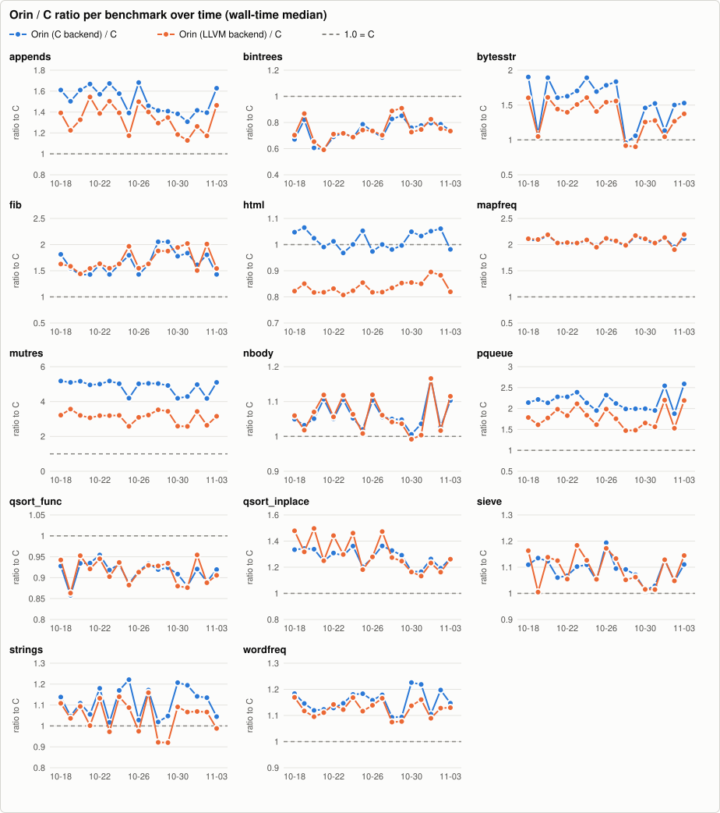
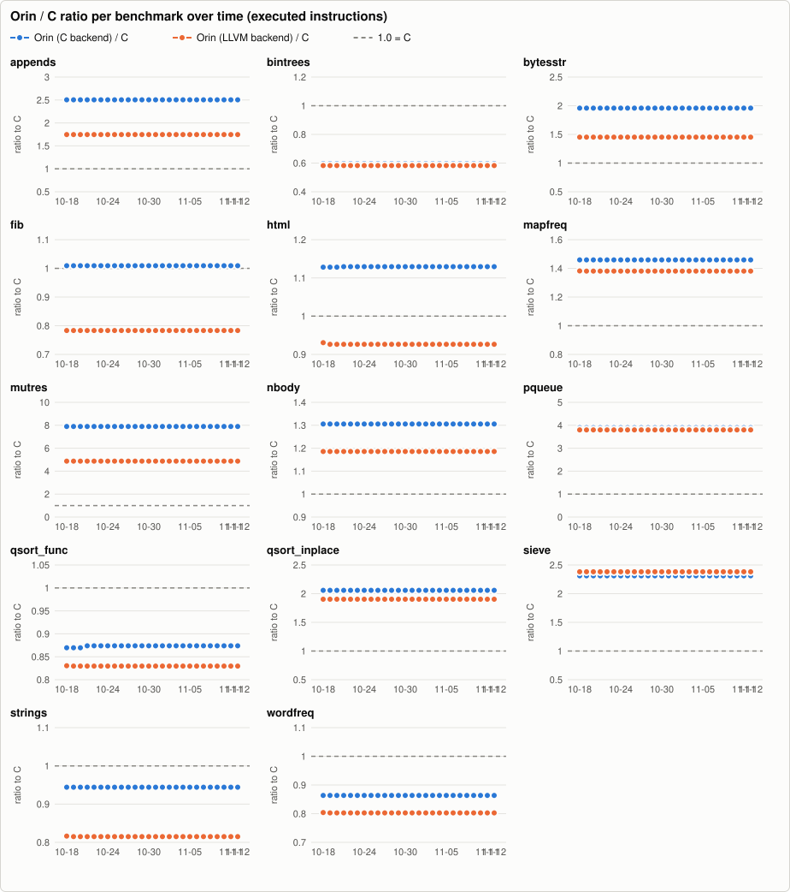
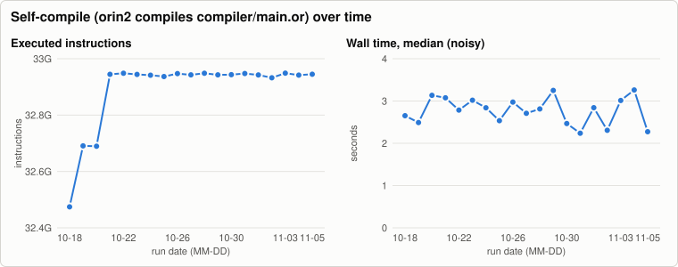
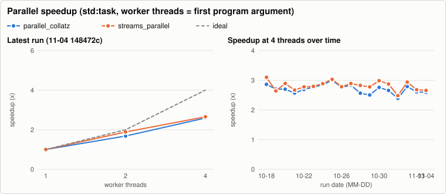

# Orin benchmark history

Written by `.github/workflows/bench.yml` (nightly and manual runs on `main`); one JSON file per run in [`history/`](history/), charts rendered by `tooling/benchmarks` (`bench-report render`, no external services). The same data as a stand-alone page: [`report.html`](report.html). Metrics and methodology: `docs/benchmarks.md` on `main`. Do not edit this branch by hand.

19 runs, 2026-10-18 to 2026-11-05. Latest: [`148472c2cd`](https://github.com/orin-lang/orin-lang/commit/148472c2cdb025d701598706b95f6b90f7f7fa44).

Instruction counts are the regression metric: they are deterministic for single-threaded programs, while wall time on a shared runner moves by 10-25 % between identical binaries.

## Latest run

Commit `148472c2cd` (main), 2026-11-05T11:55:43Z. Machine: AMD EPYC 9V45 96-Core Processor, 4 cores, 15.6 GiB, Linux-7.0.0-1017-azure-x86_64-with-glibc2.39. Runs per cell: 5 (median after one warm-up).

Tool versions

- cc: `cc (Ubuntu 13.3.0-6ubuntu2~24.04.1) 13.3.0`
- clang: `Ubuntu clang version 18.1.3 (1ubuntu1)`
- go: `go version go1.24.13 linux/amd64`
- java: `openjdk version "21.0.13" 2026-10-20 LTS`
- python: `3.12.3`
- rustc: `rustc 1.99.1 (58cf8f9c3 2026-10-13)`
- valgrind: `valgrind-3.22.0`

### Wall time, seconds (median; min-max)

| benchmark | Orin (C backend) | Orin (LLVM backend) | C | Go | Java | Rust |
|---|---:|---:|---:|---:|---:|---:|
| appends | 0.005 (0.005-0.005) | 0.005 (0.005-0.005) | 0.004 (0.004-0.007) | 0.007 (0.006-0.007) | 0.057 (0.048-0.059) | 0.003 (0.003-0.003) |
| bintrees | 0.247 (0.246-0.304) | 0.236 (0.231-0.236) | 0.314 (0.311-0.321) | 0.732 (0.718-0.738) | 0.223 (0.219-0.235) | 0.399 (0.395-0.400) |
| bytesstr | 0.025 (0.025-0.025) | 0.021 (0.021-0.022) | 0.017 (0.016-0.017) | 0.006 (0.006-0.008) | 0.075 (0.073-0.076) | 0.031 (0.030-0.032) |
| fib | 0.191 (0.189-0.192) | 0.210 (0.208-0.223) | 0.106 (0.106-0.112) | 0.373 (0.372-0.375) | 0.271 (0.270-0.277) | 0.206 (0.204-0.207) |
| html | 0.088 (0.087-0.090) | 0.073 (0.073-0.074) | 0.086 (0.084-0.088) | 0.138 (0.136-0.140) | n/a | n/a |
| html_hand | 0.075 (0.073-0.076) | 0.054 (0.053-0.054) | n/a | n/a | n/a | n/a |
| http_parse | 0.068 (0.068-0.069) | 0.055 (0.054-0.055) | n/a | n/a | n/a | n/a |
| mapfreq | 0.095 (0.093-0.097) | 0.093 (0.093-0.096) | 0.046 (0.045-0.048) | 0.066 (0.066-0.067) | n/a | n/a |
| mutres | 0.092 (0.090-0.098) | 0.054 (0.054-0.055) | 0.021 (0.021-0.021) | 0.023 (0.023-0.023) | 0.059 (0.058-0.063) | 0.026 (0.026-0.026) |
| nbody | 0.046 (0.045-0.048) | 0.045 (0.045-0.045) | 0.045 (0.045-0.045) | 0.058 (0.058-0.060) | n/a | n/a |
| pqueue | 0.092 (0.092-0.093) | 0.076 (0.075-0.076) | 0.048 (0.048-0.049) | 0.131 (0.126-0.158) | 0.160 (0.157-0.163) | 0.056 (0.056-0.057) |
| qsort_func | 0.148 (0.147-0.156) | 0.147 (0.146-0.196) | 0.165 (0.165-0.167) | 0.253 (0.243-0.254) | n/a | n/a |
| qsort_inplace | 0.085 (0.085-0.085) | 0.083 (0.082-0.083) | 0.073 (0.072-0.073) | 0.083 (0.082-0.086) | n/a | n/a |
| sieve | 0.073 (0.072-0.074) | 0.073 (0.073-0.074) | 0.070 (0.070-0.071) | 0.150 (0.144-0.167) | 0.123 (0.122-0.126) | 0.070 (0.070-0.070) |
| sortedmap | 0.154 (0.153-0.157) | 0.157 (0.156-0.161) | n/a | n/a | n/a | n/a |
| streams | 0.084 (0.081-0.085) | 0.075 (0.071-0.076) | n/a | n/a | n/a | n/a |
| strings | 0.051 (0.050-0.052) | 0.047 (0.046-0.048) | 0.044 (0.043-0.044) | 0.045 (0.039-0.047) | 0.177 (0.171-0.179) | 0.021 (0.021-0.025) |
| tasks | 3.000 (2.934-3.073) | 2.925 (2.912-3.030) | n/a | n/a | n/a | n/a |
| url | 0.214 (0.207-0.216) | 0.172 (0.170-0.195) | n/a | n/a | n/a | n/a |
| wordfreq | 0.078 (0.077-0.078) | 0.073 (0.072-0.074) | 0.064 (0.063-0.064) | 0.078 (0.077-0.079) | n/a | n/a |

### Ratio to C (wall-time median; lower is better, 1.00x = as fast as C)

| benchmark | Orin C/C | Orin LLVM/C | Go/C | Java/C | Rust/C |
|---|---:|---:|---:|---:|---:|
| appends | 1.38x | 1.19x | 1.73x | 14.73x | 0.75x |
| bintrees | 0.79x | 0.75x | 2.33x | 0.71x | 1.27x |
| bytesstr | 1.50x | 1.28x | 0.35x | 4.49x | 1.87x |
| fib | 1.79x | 1.97x | 3.50x | 2.55x | 1.94x |
| html | 1.02x | 0.85x | 1.59x | n/a | n/a |
| html_hand | n/a | n/a | n/a | n/a | n/a |
| http_parse | n/a | n/a | n/a | n/a | n/a |
| mapfreq | 2.04x | 2.00x | 1.42x | n/a | n/a |
| mutres | 4.45x | 2.59x | 1.11x | 2.84x | 1.24x |
| nbody | 1.02x | 1.01x | 1.30x | n/a | n/a |
| pqueue | 1.91x | 1.57x | 2.70x | 3.31x | 1.16x |
| qsort_func | 0.89x | 0.89x | 1.53x | n/a | n/a |
| qsort_inplace | 1.17x | 1.14x | 1.14x | n/a | n/a |
| sieve | 1.04x | 1.04x | 2.13x | 1.75x | 1.00x |
| sortedmap | n/a | n/a | n/a | n/a | n/a |
| streams | n/a | n/a | n/a | n/a | n/a |
| strings | 1.18x | 1.08x | 1.02x | 4.04x | 0.48x |
| tasks | n/a | n/a | n/a | n/a | n/a |
| url | n/a | n/a | n/a | n/a | n/a |
| wordfreq | 1.22x | 1.15x | 1.22x | n/a | n/a |

### CPU time (user + sys, median s) and peak RSS (MiB)

| benchmark | orin CPU | llvm CPU | c CPU | go CPU | java CPU | rust CPU | orin RSS | llvm RSS | c RSS | go RSS | java RSS | rust RSS |
|---|---:|---:|---:|---:|---:|---:|---:|---:|---:|---:|---:|---:|
| appends | 0.005 | 0.004 | 0.004 | 0.009 | 0.074 | 0.003 | 4.6 | 4.8 | 4.9 | 7.9 | 48.2 | 5.0 |
| bintrees | 0.246 | 0.235 | 0.313 | 1.559 | 0.258 | 0.398 | 17.6 | 17.9 | 9.7 | 13.2 | 301.2 | 10.1 |
| bytesstr | 0.025 | 0.021 | 0.016 | 0.008 | 0.088 | 0.031 | 11.6 | 11.8 | 11.7 | 6.3 | 104.5 | 5.0 |
| fib | 0.190 | 0.209 | 0.106 | 0.374 | 0.279 | 0.206 | 1.6 | 1.9 | 1.6 | 1.7 | 38.6 | 2.1 |
| html | 0.088 | 0.073 | 0.086 | 0.182 | n/a | n/a | 3.9 | 4.2 | 2.2 | 7.4 | n/a | n/a |
| html_hand | 0.075 | 0.053 | n/a | n/a | n/a | n/a | 2.5 | 2.9 | n/a | n/a | n/a | n/a |
| http_parse | 0.068 | 0.054 | n/a | n/a | n/a | n/a | 1.7 | 2.1 | n/a | n/a | n/a | n/a |
| mapfreq | 0.095 | 0.093 | 0.046 | 0.074 | n/a | n/a | 11.4 | 11.7 | 5.1 | 7.2 | n/a | n/a |
| mutres | 0.092 | 0.053 | 0.021 | 0.023 | 0.080 | 0.025 | 1.6 | 1.9 | 1.6 | 1.6 | 39.1 | 2.1 |
| nbody | 0.045 | 0.045 | 0.045 | 0.059 | n/a | n/a | 1.9 | 1.9 | 2.0 | 1.7 | n/a | n/a |
| pqueue | 0.092 | 0.076 | 0.048 | 0.136 | 0.206 | 0.056 | 6.2 | 6.5 | 4.9 | 14.6 | 62.0 | 5.1 |
| qsort_func | 0.148 | 0.147 | 0.165 | 0.304 | n/a | n/a | 36.5 | 36.8 | 23.8 | 36.8 | n/a | n/a |
| qsort_inplace | 0.085 | 0.083 | 0.072 | 0.094 | n/a | n/a | 16.8 | 17.1 | 16.9 | 24.4 | n/a | n/a |
| sieve | 0.073 | 0.073 | 0.070 | 0.251 | 0.143 | 0.070 | 77.8 | 78.1 | 77.7 | 185.9 | 116.0 | 78.3 |
| sortedmap | 0.154 | 0.157 | n/a | n/a | n/a | n/a | 11.3 | 11.5 | n/a | n/a | n/a | n/a |
| streams | 0.082 | 0.075 | n/a | n/a | n/a | n/a | 39.8 | 40.0 | n/a | n/a | n/a | n/a |
| strings | 0.051 | 0.047 | 0.043 | 0.056 | 0.340 | 0.021 | 46.2 | 46.5 | 34.7 | 23.3 | 139.4 | 20.0 |
| tasks | 3.434 | 3.313 | n/a | n/a | n/a | n/a | 14.2 | 14.7 | n/a | n/a | n/a | n/a |
| url | 0.213 | 0.172 | n/a | n/a | n/a | n/a | 6.5 | 6.8 | n/a | n/a | n/a | n/a |
| wordfreq | 0.078 | 0.073 | 0.064 | 0.079 | n/a | n/a | 2.4 | 2.6 | 2.0 | 6.7 | n/a | n/a |

### Executed instructions (valgrind; the regression metric)

| benchmark | Orin C | Orin LLVM | C | Orin C/C | Orin LLVM/C | note |
|---|---:|---:|---:|---:|---:|---|
| appends | 63,532,187 | 44,305,032 | 25,381,150 | 2.50x | 1.75x |  |
| bintrees | 4,323,683,959 | 4,219,297,433 | 7,242,293,438 | 0.60x | 0.58x |  |
| bytesstr | 349,909,247 | 259,440,726 | 178,695,502 | 1.96x | 1.45x |  |
| fib | 3,200,320,090 | 2,483,953,632 | 3,170,983,191 | 1.01x | 0.78x |  |
| html | 1,786,500,088 | 1,465,345,195 | 1,581,660,490 | 1.13x | 0.93x |  |
| html_hand | 1,335,187,118 | 980,559,871 | n/a | n/a | n/a |  |
| http_parse | 1,494,543,473 | 1,314,023,608 | n/a | n/a | n/a |  |
| mapfreq | 1,050,476,715 | 993,975,283 | 719,855,461 | 1.46x | 1.38x |  |
| mutres | 2,300,282,880 | 1,420,255,438 | 291,450,138 | 7.89x | 4.87x |  |
| nbody | 850,321,975 | 772,258,372 | 651,230,677 | 1.31x | 1.19x |  |
| pqueue | 1,383,801,402 | 1,349,545,568 | 355,213,580 | 3.90x | 3.80x |  |
| qsort_func | 1,335,897,332 | 1,268,411,924 | 1,528,677,752 | 0.87x | 0.83x |  |
| qsort_inplace | 563,393,101 | 521,077,328 | 273,751,950 | 2.06x | 1.90x |  |
| sieve | 443,198,013 | 456,725,927 | 191,756,523 | 2.31x | 2.38x |  |
| sortedmap | 1,354,678,419 | 1,354,047,042 | n/a | n/a | n/a |  |
| streams | 1,173,757,219 | 1,173,731,136 | n/a | n/a | n/a |  |
| strings | 647,534,763 | 558,940,700 | 685,893,535 | 0.94x | 0.81x |  |
| tasks | n/a | n/a | n/a | n/a | n/a | llvm skipped: multi-threaded (20,000 tasks, channels): valgrind serialises threads, so the count would include scheduler waits; orin skipped: multi-threaded (20,000 tasks, channels): valgrind serialises threads, so the count would include scheduler waits |
| url | 4,455,707,373 | 4,066,090,876 | n/a | n/a | n/a |  |
| wordfreq | 760,380,161 | 706,684,023 | 880,390,194 | 0.86x | 0.80x |  |

### Parallel speedup (std:task; worker threads = first argument of the program)

| benchmark | threads | wall s (min-max) | CPU s (user+sys) | speedup | efficiency | CPU vs 1 thread | output |
|---|---:|---:|---:|---:|---:|---:|---|
| parallel_collatz | 1 | 0.391 (0.389-0.400) | 0.391 | 1.00x | 100 % | 1.00x | same |
| parallel_collatz | 2 | 0.231 (0.228-0.255) | 0.419 | 1.69x | 85 % | 1.07x | same |
| parallel_collatz | 4 | 0.142 (0.139-0.143) | 0.479 | 2.76x | 69 % | 1.23x | same |
| streams_parallel | 1 | 0.444 (0.437-0.483) | 0.444 | 1.00x | 100 % | 1.00x | same |
| streams_parallel | 2 | 0.230 (0.229-0.238) | 0.442 | 1.93x | 97 % | 1.00x | same |
| streams_parallel | 4 | 0.149 (0.148-0.151) | 0.541 | 2.98x | 75 % | 1.22x | same |

Speedup = wall(1 thread) / wall(n); efficiency = speedup / n. CPU time that grows with n is overhead or oversubscription (more threads than free cores).

### Self-compile (orin2 compiles compiler/main.or)

| wall s (min-max) | CPU s | peak RSS MiB | instructions | output identical to stage2.c |
|---:|---:|---:|---:|---|
| 2.273 (2.266-2.382) | 3.613 | 426.4 | 32,945,209,327 | yes |

## All runs

| date | commit | ref | self-compile instructions | self-compile wall s | file |
|---|---|---|---:|---:|---|
| 2026-11-05T11:55:43Z | `148472c2cd` | main | 32,945,209,327 | 2.273 | [json](history/2026-11-05-148472c2cdb0.json) |
| 2026-11-04T12:03:12Z | `148472c2cd` | main | 32,941,929,762 | 3.262 | [json](history/2026-11-04-148472c2cdb0.json) |
| 2026-11-03T11:47:47Z | `148472c2cd` | main | 32,948,784,955 | 3.012 | [json](history/2026-11-03-148472c2cdb0.json) |
| 2026-11-02T12:05:49Z | `148472c2cd` | main | 32,932,422,001 | 2.307 | [json](history/2026-11-02-148472c2cdb0.json) |
| 2026-11-01T11:14:05Z | `148472c2cd` | main | 32,942,553,657 | 2.842 | [json](history/2026-11-01-148472c2cdb0.json) |
| 2026-10-31T10:16:06Z | `148472c2cd` | main | 32,947,431,130 | 2.238 | [json](history/2026-10-31-148472c2cdb0.json) |
| 2026-10-30T10:51:26Z | `148472c2cd` | main | 32,943,606,281 | 2.468 | [json](history/2026-10-30-148472c2cdb0.json) |
| 2026-10-29T10:55:59Z | `148472c2cd` | main | 32,942,981,735 | 3.250 | [json](history/2026-10-29-148472c2cdb0.json) |
| 2026-10-28T10:31:52Z | `148472c2cd` | main | 32,948,464,083 | 2.813 | [json](history/2026-10-28-148472c2cdb0.json) |
| 2026-10-27T09:43:14Z | `148472c2cd` | main | 32,942,699,177 | 2.709 | [json](history/2026-10-27-148472c2cdb0.json) |
| 2026-10-26T09:51:02Z | `148472c2cd` | main | 32,947,201,465 | 2.974 | [json](history/2026-10-26-148472c2cdb0.json) |
| 2026-10-25T09:03:06Z | `148472c2cd` | main | 32,936,964,885 | 2.535 | [json](history/2026-10-25-148472c2cdb0.json) |
| 2026-10-24T08:45:58Z | `148472c2cd` | main | 32,941,665,170 | 2.841 | [json](history/2026-10-24-148472c2cdb0.json) |
| 2026-10-23T09:15:05Z | `148472c2cd` | main | 32,944,434,877 | 3.020 | [json](history/2026-10-23-148472c2cdb0.json) |
| 2026-10-22T09:19:15Z | `148472c2cd` | main | 32,948,490,800 | 2.785 | [json](history/2026-10-22-148472c2cdb0.json) |
| 2026-10-21T09:18:17Z | `148472c2cd` | main | 32,944,599,759 | 3.076 | [json](history/2026-10-21-148472c2cdb0.json) |
| 2026-10-20T09:18:44Z | `4fca791aa7` | main | 32,689,556,132 | 3.135 | [json](history/2026-10-20-4fca791aa730.json) |
| 2026-10-19T09:42:12Z | `4fca791aa7` | main | 32,690,856,642 | 2.491 | [json](history/2026-10-19-4fca791aa730.json) |
| 2026-10-18T08:41:01Z | `f9a96b20cf` | main | 32,474,433,787 | 2.653 | [json](history/2026-10-18-f9a96b20cf4a.json) |
