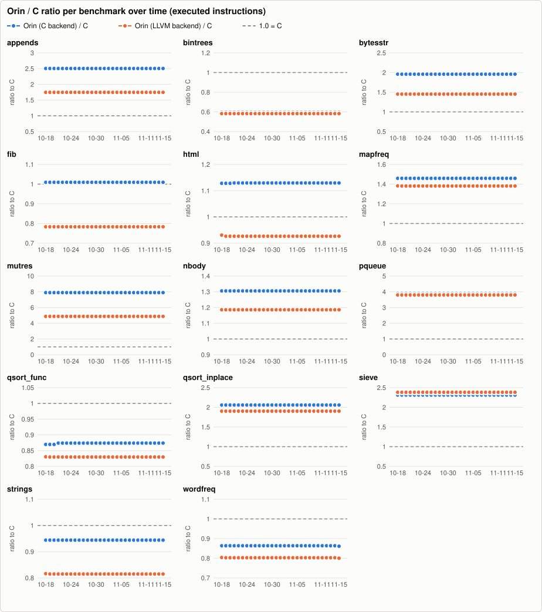

# Orin benchmark history

Written by `.github/workflows/bench.yml` (nightly and manual runs on `main`); one JSON file per run in [`history/`](history/), charts rendered by `tooling/benchmarks` (`bench-report render`, no external services). The same data as a stand-alone page: [`report.html`](report.html). Metrics and methodology: `docs/benchmarks.md` on `main`. Do not edit this branch by hand.

34 runs, 2026-10-18 to 2026-11-21. Latest: [`148472c2cd`](https://github.com/orin-lang/orin-lang/commit/148472c2cdb025d701598706b95f6b90f7f7fa44).

Instruction counts are the regression metric: they are deterministic for single-threaded programs, while wall time on a shared runner moves by 10-25 % between identical binaries.

## Latest run

Commit `148472c2cd` (main), 2026-11-21T12:14:55Z. Machine: INTEL(R) XEON(R) PLATINUM 8573C, 4 cores, 15.6 GiB, Linux-7.0.0-1020-azure-x86_64-with-glibc2.43. Runs per cell: 5 (median after one warm-up).

Tool versions

- cc: `cc (Ubuntu 15.2.0-16ubuntu1) 15.2.0`
- clang: `Ubuntu clang version 21.1.8 (6ubuntu1)`
- go: `go version go1.24.13 linux/amd64`
- java: `openjdk version "21.0.13" 2026-10-20 LTS`
- python: `3.14.4`
- rustc: `rustc 1.100.0 (0ef1bc386 2026-11-09)`
- valgrind: `valgrind-3.26.0`

### Wall time, seconds (median; min-max)

| benchmark | Orin (C backend) | Orin (LLVM backend) | C | Go | Java | Rust |
|---|---:|---:|---:|---:|---:|---:|
| appends | 0.007 (0.007-0.007) | 0.006 (0.006-0.007) | 0.004 (0.004-0.004) | 0.010 (0.008-0.011) | 0.076 (0.067-0.082) | 0.004 (0.004-0.008) |
| bintrees | 0.473 (0.471-0.477) | 0.472 (0.468-0.492) | 0.889 (0.888-0.894) | 1.154 (1.150-1.174) | 0.352 (0.350-0.355) | 1.022 (1.019-1.029) |
| bytesstr | 0.043 (0.040-0.044) | 0.038 (0.037-0.040) | 0.036 (0.034-0.037) | 0.010 (0.008-0.010) | 0.100 (0.098-0.107) | 0.030 (0.030-0.031) |
| fib | 0.375 (0.374-0.376) | 0.397 (0.396-0.399) | 0.159 (0.158-0.160) | 0.580 (0.580-0.581) | 0.533 (0.531-0.537) | 0.313 (0.313-0.314) |
| html | 0.149 (0.149-0.151) | 0.123 (0.122-0.124) | 0.139 (0.138-0.140) | 0.246 (0.243-0.257) | n/a | n/a |
| html_hand | 0.127 (0.127-0.128) | 0.100 (0.098-0.101) | n/a | n/a | n/a | n/a |
| http_parse | 0.112 (0.111-0.113) | 0.092 (0.091-0.092) | n/a | n/a | n/a | n/a |
| mapfreq | 0.137 (0.135-0.138) | 0.138 (0.138-0.140) | 0.066 (0.066-0.071) | 0.104 (0.101-0.105) | n/a | n/a |
| mutres | 0.127 (0.127-0.128) | 0.086 (0.086-0.087) | 0.032 (0.031-0.032) | 0.076 (0.075-0.076) | 0.084 (0.081-0.087) | 0.030 (0.028-0.030) |
| nbody | 0.055 (0.054-0.055) | 0.059 (0.059-0.059) | 0.061 (0.061-0.063) | 0.090 (0.090-0.090) | n/a | n/a |
| pqueue | 0.151 (0.150-0.154) | 0.113 (0.110-0.115) | 0.080 (0.079-0.080) | 0.189 (0.188-0.190) | 0.249 (0.247-0.252) | 0.087 (0.086-0.088) |
| qsort_func | 0.230 (0.229-0.234) | 0.232 (0.231-0.234) | 0.202 (0.200-0.202) | 0.391 (0.385-0.399) | n/a | n/a |
| qsort_inplace | 0.126 (0.125-0.126) | 0.122 (0.122-0.123) | 0.098 (0.098-0.099) | 0.111 (0.111-0.114) | n/a | n/a |
| sieve | 0.168 (0.161-0.174) | 0.170 (0.157-0.185) | 0.160 (0.151-0.171) | 0.337 (0.276-0.653) | 0.259 (0.246-0.282) | 0.182 (0.179-0.194) |
| sortedmap | 0.246 (0.245-0.250) | 0.251 (0.250-0.254) | n/a | n/a | n/a | n/a |
| streams | 0.152 (0.147-0.153) | 0.132 (0.130-0.137) | n/a | n/a | n/a | n/a |
| strings | 0.070 (0.068-0.070) | 0.064 (0.063-0.065) | 0.066 (0.065-0.066) | 0.064 (0.058-0.066) | 0.243 (0.235-0.273) | 0.031 (0.030-0.031) |
| tasks | 4.456 (4.179-4.544) | 4.212 (4.129-4.475) | n/a | n/a | n/a | n/a |
| url | 0.338 (0.337-0.343) | 0.328 (0.327-0.330) | n/a | n/a | n/a | n/a |
| wordfreq | 0.112 (0.112-0.113) | 0.113 (0.113-0.113) | 0.101 (0.101-0.102) | 0.117 (0.116-0.117) | n/a | n/a |

### Ratio to C (wall-time median; lower is better, 1.00x = as fast as C)

| benchmark | Orin C/C | Orin LLVM/C | Go/C | Java/C | Rust/C |
|---|---:|---:|---:|---:|---:|
| appends | 1.78x | 1.55x | 2.38x | 18.31x | 0.94x |
| bintrees | 0.53x | 0.53x | 1.30x | 0.40x | 1.15x |
| bytesstr | 1.19x | 1.07x | 0.27x | 2.78x | 0.84x |
| fib | 2.36x | 2.49x | 3.64x | 3.35x | 1.97x |
| html | 1.07x | 0.89x | 1.77x | n/a | n/a |
| html_hand | n/a | n/a | n/a | n/a | n/a |
| http_parse | n/a | n/a | n/a | n/a | n/a |
| mapfreq | 2.06x | 2.09x | 1.57x | n/a | n/a |
| mutres | 3.98x | 2.71x | 2.38x | 2.63x | 0.93x |
| nbody | 0.89x | 0.96x | 1.47x | n/a | n/a |
| pqueue | 1.90x | 1.41x | 2.38x | 3.12x | 1.10x |
| qsort_func | 1.14x | 1.15x | 1.94x | n/a | n/a |
| qsort_inplace | 1.28x | 1.24x | 1.14x | n/a | n/a |
| sieve | 1.05x | 1.06x | 2.11x | 1.62x | 1.14x |
| sortedmap | n/a | n/a | n/a | n/a | n/a |
| streams | n/a | n/a | n/a | n/a | n/a |
| strings | 1.06x | 0.97x | 0.97x | 3.69x | 0.47x |
| tasks | n/a | n/a | n/a | n/a | n/a |
| url | n/a | n/a | n/a | n/a | n/a |
| wordfreq | 1.11x | 1.11x | 1.15x | n/a | n/a |

### CPU time (user + sys, median s) and peak RSS (MiB)

| benchmark | orin CPU | llvm CPU | c CPU | go CPU | java CPU | rust CPU | orin RSS | llvm RSS | c RSS | go RSS | java RSS | rust RSS |
|---|---:|---:|---:|---:|---:|---:|---:|---:|---:|---:|---:|---:|
| appends | 0.007 | 0.006 | 0.004 | 0.013 | 0.111 | 0.003 | 4.8 | 5.0 | 4.8 | 8.9 | 48.2 | 5.2 |
| bintrees | 0.473 | 0.470 | 0.888 | 2.535 | 0.411 | 1.022 | 17.6 | 17.8 | 9.6 | 13.1 | 301.3 | 10.0 |
| bytesstr | 0.042 | 0.038 | 0.035 | 0.013 | 0.122 | 0.030 | 11.7 | 11.8 | 11.6 | 6.3 | 104.6 | 5.1 |
| fib | 0.375 | 0.396 | 0.158 | 0.581 | 0.552 | 0.313 | 1.6 | 1.8 | 1.5 | 1.7 | 38.8 | 2.1 |
| html | 0.148 | 0.123 | 0.138 | 0.321 | n/a | n/a | 4.0 | 4.2 | 2.1 | 7.9 | n/a | n/a |
| html_hand | 0.127 | 0.099 | n/a | n/a | n/a | n/a | 2.6 | 2.9 | n/a | n/a | n/a | n/a |
| http_parse | 0.111 | 0.091 | n/a | n/a | n/a | n/a | 1.8 | 1.9 | n/a | n/a | n/a | n/a |
| mapfreq | 0.136 | 0.138 | 0.066 | 0.121 | n/a | n/a | 11.2 | 11.4 | 5.0 | 7.4 | n/a | n/a |
| mutres | 0.126 | 0.086 | 0.031 | 0.076 | 0.122 | 0.029 | 1.6 | 1.8 | 1.5 | 1.7 | 39.3 | 2.1 |
| nbody | 0.054 | 0.058 | 0.061 | 0.090 | n/a | n/a | 1.9 | 1.9 | 1.8 | 1.6 | n/a | n/a |
| pqueue | 0.151 | 0.112 | 0.079 | 0.196 | 0.321 | 0.087 | 6.3 | 6.5 | 4.8 | 14.7 | 62.0 | 5.2 |
| qsort_func | 0.229 | 0.231 | 0.201 | 0.472 | n/a | n/a | 36.4 | 36.6 | 22.0 | 37.4 | n/a | n/a |
| qsort_inplace | 0.125 | 0.121 | 0.097 | 0.127 | n/a | n/a | 17.0 | 17.1 | 16.8 | 26.1 | n/a | n/a |
| sieve | 0.167 | 0.168 | 0.159 | 0.502 | 0.292 | 0.181 | 78.0 | 78.3 | 77.7 | 231.9 | 116.2 | 78.4 |
| sortedmap | 0.246 | 0.250 | n/a | n/a | n/a | n/a | 11.2 | 11.4 | n/a | n/a | n/a | n/a |
| streams | 0.152 | 0.131 | n/a | n/a | n/a | n/a | 39.9 | 40.0 | n/a | n/a | n/a | n/a |
| strings | 0.069 | 0.063 | 0.065 | 0.078 | 0.515 | 0.030 | 46.3 | 46.5 | 34.8 | 23.6 | 139.5 | 20.1 |
| tasks | 4.349 | 4.291 | n/a | n/a | n/a | n/a | 14.2 | 14.3 | n/a | n/a | n/a | n/a |
| url | 0.338 | 0.327 | n/a | n/a | n/a | n/a | 6.6 | 6.8 | n/a | n/a | n/a | n/a |
| wordfreq | 0.112 | 0.112 | 0.101 | 0.119 | n/a | n/a | 2.3 | 2.6 | 1.9 | 6.5 | n/a | n/a |

### Executed instructions (valgrind; the regression metric)

| benchmark | Orin C | Orin LLVM | C | Orin C/C | Orin LLVM/C | note |
|---|---:|---:|---:|---:|---:|---|
| appends | 60,400,606 | 43,975,658 | 18,927,362 | 3.19x | 2.32x |  |
| bintrees | 4,217,620,511 | 4,213,208,414 | 11,630,513,487 | 0.36x | 0.36x |  |
| bytesstr | 349,647,141 | 259,441,956 | 103,926,179 | 3.36x | 2.50x |  |
| fib | 3,200,259,808 | 2,342,472,432 | 2,780,168,025 | 1.15x | 0.84x |  |
| html | 1,578,539,715 | 1,381,614,046 | 1,521,579,597 | 1.04x | 0.91x |  |
| html_hand | 1,201,359,326 | 981,754,879 | n/a | n/a | n/a |  |
| http_parse | 1,466,351,609 | 1,315,702,334 | n/a | n/a | n/a |  |
| mapfreq | 1,013,671,870 | 996,589,343 | 681,408,294 | 1.49x | 1.46x |  |
| mutres | 2,280,222,342 | 1,420,196,407 | 267,648,838 | 8.52x | 5.31x |  |
| nbody | 655,257,509 | 768,198,964 | 386,175,662 | 1.70x | 1.99x |  |
| pqueue | 1,345,424,376 | 1,321,812,336 | 359,470,793 | 3.74x | 3.68x |  |
| qsort_func | 1,321,582,510 | 1,278,327,655 | 1,064,640,580 | 1.24x | 1.20x |  |
| qsort_inplace | 609,054,278 | 521,083,870 | 275,674,807 | 2.21x | 1.89x |  |
| sieve | 423,203,312 | 451,732,345 | 161,705,036 | 2.62x | 2.79x |  |
| sortedmap | 1,332,999,715 | 1,338,880,433 | n/a | n/a | n/a |  |
| streams | 1,207,160,677 | 1,173,802,976 | n/a | n/a | n/a |  |
| strings | 653,262,497 | 578,559,242 | 734,241,501 | 0.89x | 0.79x |  |
| tasks | n/a | n/a | n/a | n/a | n/a | llvm skipped: multi-threaded (20,000 tasks, channels): valgrind serialises threads, so the count would include scheduler waits; orin skipped: multi-threaded (20,000 tasks, channels): valgrind serialises threads, so the count would include scheduler waits |
| url | 4,188,201,717 | 4,071,298,635 | n/a | n/a | n/a |  |
| wordfreq | 758,664,398 | 707,702,180 | 864,991,374 | 0.88x | 0.82x |  |

### Parallel speedup (std:task; worker threads = first argument of the program)

| benchmark | threads | wall s (min-max) | CPU s (user+sys) | speedup | efficiency | CPU vs 1 thread | output |
|---|---:|---:|---:|---:|---:|---:|---|
| parallel_collatz | 1 | 0.763 (0.760-0.764) | 0.762 | 1.00x | 100 % | 1.00x | same |
| parallel_collatz | 2 | 0.433 (0.431-0.435) | 0.797 | 1.76x | 88 % | 1.05x | same |
| parallel_collatz | 4 | 0.308 (0.307-0.311) | 1.076 | 2.47x | 62 % | 1.41x | same |
| streams_parallel | 1 | 0.701 (0.699-0.702) | 0.699 | 1.00x | 100 % | 1.00x | same |
| streams_parallel | 2 | 0.364 (0.363-0.364) | 0.703 | 1.93x | 96 % | 1.01x | same |
| streams_parallel | 4 | 0.258 (0.257-0.259) | 0.957 | 2.72x | 68 % | 1.37x | same |

Speedup = wall(1 thread) / wall(n); efficiency = speedup / n. CPU time that grows with n is overhead or oversubscription (more threads than free cores).

### Self-compile (orin2 compiles compiler/main.or)

| wall s (min-max) | CPU s | peak RSS MiB | instructions | output identical to stage2.c |
|---:|---:|---:|---:|---|
| 2.830 (2.821-2.888) | 4.906 | 427.0 | 32,507,877,584 | yes |

## All runs

| date | commit | ref | self-compile instructions | self-compile wall s | file |
|---|---|---|---:|---:|---|
| 2026-11-21T12:14:55Z | `148472c2cd` | main | 32,507,877,584 | 2.830 | [json](history/2026-11-21-148472c2cdb0.json) |
| 2026-11-20T12:37:57Z | `148472c2cd` | main | 32,508,382,018 | 2.292 | [json](history/2026-11-20-148472c2cdb0.json) |
| 2026-11-18T12:45:56Z | `148472c2cd` | main | 32,508,554,009 | 2.657 | [json](history/2026-11-18-148472c2cdb0.json) |
| 2026-11-17T12:56:05Z | `148472c2cd` | main | 32,508,876,011 | 2.317 | [json](history/2026-11-17-148472c2cdb0.json) |
| 2026-11-16T12:36:50Z | `148472c2cd` | main | 32,941,276,491 | 2.935 | [json](history/2026-11-16-148472c2cdb0.json) |
| 2026-11-15T11:55:27Z | `148472c2cd` | main | 32,947,512,412 | 2.250 | [json](history/2026-11-15-148472c2cdb0.json) |
| 2026-11-14T11:18:28Z | `148472c2cd` | main | 32,948,196,811 | 2.224 | [json](history/2026-11-14-148472c2cdb0.json) |
| 2026-11-13T12:02:20Z | `148472c2cd` | main | 32,944,948,551 | 2.962 | [json](history/2026-11-13-148472c2cdb0.json) |
| 2026-11-12T12:13:12Z | `148472c2cd` | main | 32,946,589,724 | 2.245 | [json](history/2026-11-12-148472c2cdb0.json) |
| 2026-11-11T11:53:54Z | `148472c2cd` | main | 32,947,093,605 | 3.132 | [json](history/2026-11-11-148472c2cdb0.json) |
| 2026-11-10T12:13:41Z | `148472c2cd` | main | 32,946,478,802 | 2.528 | [json](history/2026-11-10-148472c2cdb0.json) |
| 2026-11-09T12:41:22Z | `148472c2cd` | main | 32,943,133,157 | 3.155 | [json](history/2026-11-09-148472c2cdb0.json) |
| 2026-11-08T11:10:36Z | `148472c2cd` | main | 32,942,986,207 | 2.851 | [json](history/2026-11-08-148472c2cdb0.json) |
| 2026-11-07T11:06:25Z | `148472c2cd` | main | 32,947,521,547 | 2.963 | [json](history/2026-11-07-148472c2cdb0.json) |
| 2026-11-06T11:56:28Z | `148472c2cd` | main | 32,943,001,622 | 2.818 | [json](history/2026-11-06-148472c2cdb0.json) |
| 2026-11-05T11:55:43Z | `148472c2cd` | main | 32,945,209,327 | 2.273 | [json](history/2026-11-05-148472c2cdb0.json) |
| 2026-11-04T12:03:12Z | `148472c2cd` | main | 32,941,929,762 | 3.262 | [json](history/2026-11-04-148472c2cdb0.json) |
| 2026-11-03T11:47:47Z | `148472c2cd` | main | 32,948,784,955 | 3.012 | [json](history/2026-11-03-148472c2cdb0.json) |
| 2026-11-02T12:05:49Z | `148472c2cd` | main | 32,932,422,001 | 2.307 | [json](history/2026-11-02-148472c2cdb0.json) |
| 2026-11-01T11:14:05Z | `148472c2cd` | main | 32,942,553,657 | 2.842 | [json](history/2026-11-01-148472c2cdb0.json) |
| 2026-10-31T10:16:06Z | `148472c2cd` | main | 32,947,431,130 | 2.238 | [json](history/2026-10-31-148472c2cdb0.json) |
| 2026-10-30T10:51:26Z | `148472c2cd` | main | 32,943,606,281 | 2.468 | [json](history/2026-10-30-148472c2cdb0.json) |
| 2026-10-29T10:55:59Z | `148472c2cd` | main | 32,942,981,735 | 3.250 | [json](history/2026-10-29-148472c2cdb0.json) |
| 2026-10-28T10:31:52Z | `148472c2cd` | main | 32,948,464,083 | 2.813 | [json](history/2026-10-28-148472c2cdb0.json) |
| 2026-10-27T09:43:14Z | `148472c2cd` | main | 32,942,699,177 | 2.709 | [json](history/2026-10-27-148472c2cdb0.json) |
| 2026-10-26T09:51:02Z | `148472c2cd` | main | 32,947,201,465 | 2.974 | [json](history/2026-10-26-148472c2cdb0.json) |
| 2026-10-25T09:03:06Z | `148472c2cd` | main | 32,936,964,885 | 2.535 | [json](history/2026-10-25-148472c2cdb0.json) |
| 2026-10-24T08:45:58Z | `148472c2cd` | main | 32,941,665,170 | 2.841 | [json](history/2026-10-24-148472c2cdb0.json) |
| 2026-10-23T09:15:05Z | `148472c2cd` | main | 32,944,434,877 | 3.020 | [json](history/2026-10-23-148472c2cdb0.json) |
| 2026-10-22T09:19:15Z | `148472c2cd` | main | 32,948,490,800 | 2.785 | [json](history/2026-10-22-148472c2cdb0.json) |
| 2026-10-21T09:18:17Z | `148472c2cd` | main | 32,944,599,759 | 3.076 | [json](history/2026-10-21-148472c2cdb0.json) |
| 2026-10-20T09:18:44Z | `4fca791aa7` | main | 32,689,556,132 | 3.135 | [json](history/2026-10-20-4fca791aa730.json) |
| 2026-10-19T09:42:12Z | `4fca791aa7` | main | 32,690,856,642 | 2.491 | [json](history/2026-10-19-4fca791aa730.json) |
| 2026-10-18T08:41:01Z | `f9a96b20cf` | main | 32,474,433,787 | 2.653 | [json](history/2026-10-18-f9a96b20cf4a.json) |
